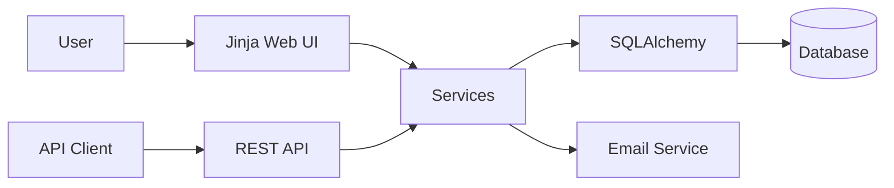

# UniNest — Final Project Report

**Degree Programme:** Diploma in Information Technology
**Project Title:** Design and Development of a University Hostel Management System
**Student:** Victor Ndirangu (25/03338)
**Report Status:** Final draft
**Date:** 23 November 2026

## Abstract

UniNest is a web-based university hostel management system developed to replace manual hostel records, spreadsheets, and fragmented application processes. The system integrates student registration, enrolment verification, hostel applications, room and bed allocation, accommodation payments, maintenance requests, notifications, and operational reports. The implementation uses Python and Flask with SQLAlchemy, Flask-JWT-Extended, Jinja templates, and a PostgreSQL-ready database configuration. It provides both a server-rendered web interface and a REST API. Automated tests were used to verify authentication, application and allocation lifecycles, payment reconciliation, role protection, maintenance, reports, and web journeys. The final test run passed all 17 tests.

## 1. Introduction

### 1.1 Background

University hostel administration involves many linked records: student eligibility, hostel inventory, applications, allocations, payments, maintenance, and reporting. Separate spreadsheets and manual forms can create duplicate records, delayed decisions, weak audit trails, and inaccurate occupancy information.

### 1.2 Problem statement

The current process has limited real-time visibility and makes it difficult to coordinate applications, bed availability, payment records, and maintenance. Students also do not receive consistent updates on their accommodation status.

### 1.3 Aim

To develop a centralized hostel management system that manages the complete student accommodation process and provides role-specific views for students, administrators, management, and maintenance staff.

### 1.4 Objectives

1. Digitize student registration and verification.
2. Automate hostel, room, bed, and allocation management.
3. Provide application status tracking and notifications.
4. Record and reconcile accommodation payments.
5. Support maintenance request processing.
6. Produce operational summaries and CSV reports.
7. Apply role-based security and data validation.

### 1.5 Project scope

UniNest covers accounts, applications, allocations, inventory, payments, maintenance, notifications, email alerts, and reports. It does not directly integrate with a university ERP or perform live payment settlement. M-Pesa details are recorded and reconciled by hostel office staff.

## 2. Literature and systems review

A centralized system offers a shared data source and repeatable workflows. Web applications are suitable for distributed access, while role-based authorization reduces the risk that users view or change functions outside their responsibilities. Relational persistence is appropriate for entities with strong relationships, such as students, applications, allocations, beds, payments, and maintenance requests. Academic and operational software should also define explicit state transitions so that records cannot move to invalid conditions such as assigning an occupied bed or holding a second active allocation.

## 3. Requirements and methodology

The project was developed using an iterative engineering methodology. Initial requirements were captured in the proposal and SRS, implemented through the Flask application, verified through tests, and corrected through feedback. The requirements distinguish between functional and non-functional needs and use MoSCoW priorities.

### 3.1 Stakeholders

- **Students:** register, apply, view allocation, submit payments, request maintenance, and receive updates.
- **Administrators:** verify students, manage inventory and applications, process allocations/payments, and issue reports.
- **Management:** view operational reports and occupancy information.
- **Maintenance staff:** work through assigned or available maintenance requests.

### 3.2 Core functional areas

- Account registration and authentication
- Student verification
- Hostel, room, and bed inventory
- Application submission and review
- Allocation and occupancy lifecycle
- Payment reconciliation
- Maintenance requests
- Notifications and email
- Operational reporting

## 4. System design

UniNest uses a layered architecture:

1. Browser templates and REST routes.
2. Shared service-layer business rules.
3. SQLAlchemy domain models.
4. SQLite in development or PostgreSQL in production.
5. Email provider integration with in-app notification fallback.

The detailed package design and entity relationships are described in `UniNest_SDS.md`.

## 5. Implementation

### 5.1 Technology stack

- Python 3.12+
- Flask
- Flask-SQLAlchemy
- Flask-Migrate
- Flask-JWT-Extended
- Jinja2
- SQLite / PostgreSQL-ready SQLAlchemy configuration
- pytest

### 5.2 Main workflows

#### Registration and verification

A student creates an account with personal and academic details. The account is unverified until an administrator checks the enrolment information. Passwords are validated and stored as hashes.

#### Application and allocation

The student submits one active application. The administrator reviews it, approves or rejects it, and allocates an available bed for an approved application. Check-in, check-out, and cancellation update allocation, application, and bed states consistently.

#### Payments

A student records an accommodation payment and the allocation reference. The office confirms or rejects the payment. Confirmation is reconciled against an explicitly configured sufficiency amount before accommodation confirmation flags are set.

#### Maintenance

Students submit requests linked to their accommodation. Administrators or maintenance staff move requests through submitted, in progress, and resolved states. A resolution note may be added.

#### Reporting

The reports page provides occupancy, vacancies, payment totals, allocation registers, and maintenance summaries. Administrator and management roles may download supported CSV reports.

## 6. Security and privacy

UniNest applies password hashing, JWT API authentication, web sessions, role checks, login throttling, CSRF protection for web forms, and privacy-safe email content. Management interfaces expose only operational fields required for oversight. Destructive actions are protected through state and history checks rather than unrestricted deletion.

## 7. Testing

### 7.1 Automated testing

The automated suite covers API and web behavior using an isolated in-memory SQLite database. Tests cover account registration/login, verification, application review, allocation lifecycle, payment confirmation, partial payments, payment rejection, report authorization, hostel management, profile updates, uploads, maintenance accounts, and the complete web journey.

**Baseline result: 17 tests passed on 23 November 2026.**

### 7.2 Test categories

- Authentication and authorization
- Verification gate
- Application and allocation transitions
- Payment sufficiency and audit fields
- Maintenance workflow
- CSV/report access
- Web POST workflow
- Password and notification privacy

### 7.3 Notable validation

- Partial payments do not confirm accommodation.
- Rejected payments retain processing timestamps.
- Unverified students cannot apply.
- Unauthorized API roles receive 403 responses.
- Short passwords are rejected.
- Student report access is denied.

The complete test strategy is recorded in `UniNest_Test_Plan.md`.

## 8. Results and achievements

The project produced a functioning system with:

- A responsive browser interface.
- REST and web interfaces over shared services.
- Role-specific dashboards.
- Lifecycle-managed accommodation records.
- Decimal payment reconciliation.
- In-app and email notifications.
- Operational reports and CSV exports.
- Automated API and web regression coverage.

## 9. Limitations

- Direct integration with Daraja/M-Pesa settlement is not implemented.
- The system has not been tested against a live ERP or external university identity system.
- Large-scale distributed load testing was not performed.
- The live SMTP provider and production HTTPS configuration depend on deployment credentials.
- UAT with real university staff should occur before institutional deployment.

## 10. Recommendations

1. Add an SMS or push notification provider if required by the university.
2. Integrate with the official student information system.
3. Configure a production PostgreSQL database and encrypted secret storage.
4. Implement formal backup and disaster recovery procedures.
5. Add periodic security review and dependency updates.
6. Extend audit logs for all administrative changes.
7. Conduct UAT with representative staff and students before production use.

## 11. Conclusion

UniNest demonstrates an effective implementation of a centralized hostel management system. It replaces disconnected manual records with connected account, application, allocation, payment, maintenance, notification, and reporting workflows. Service-level lifecycle rules and automated tests provide a foundation for integrity and future expansion. Further institutional validation and production integration remain necessary before operational deployment.

## Appendices

- Appendix A — `UniNest_SRS.md`
- Appendix B — `UniNest_SDS.md`
- Appendix C — `UniNest_Test_Plan.md`
- Appendix D — `UniNest_Implementation_Plan.md`
- Appendix E — `User_Manual.md`
- Appendix F — `docs/ARCHITECTURE.md`
