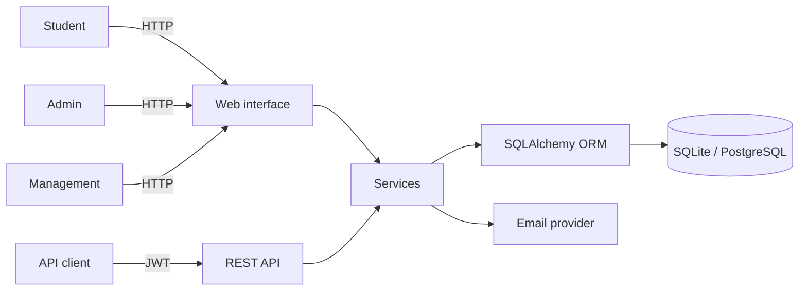
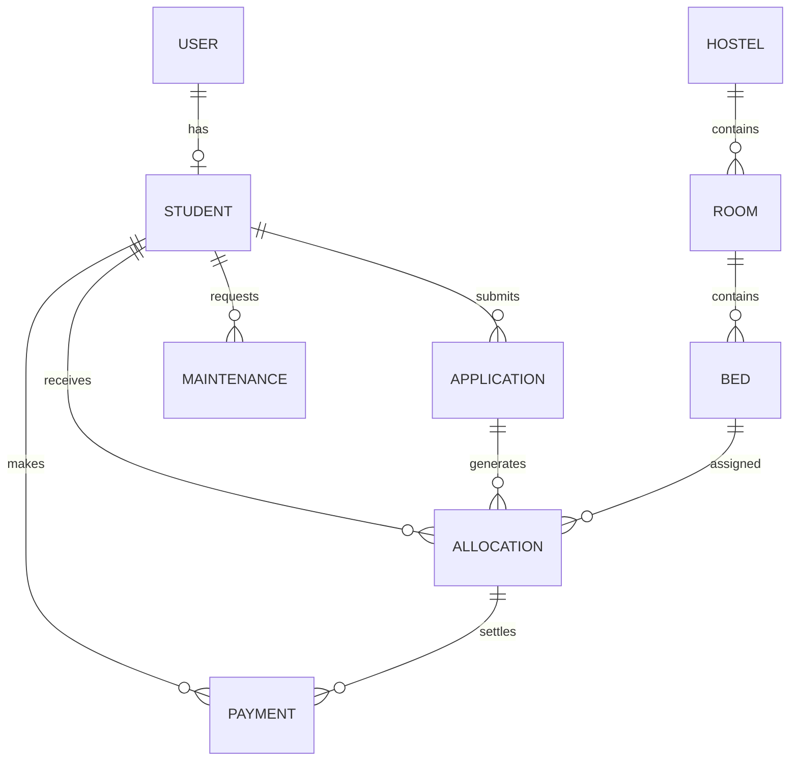

# UniNest — System Design Specification (SDS)

**Version:** 1.0
**Status:** Work in Progress
**Date:** 23 November 2026
**Project:** Diploma in Information Technology
**Student:** Victor Ndirangu (25/03338)

## 1. Introduction

### 1.1 Purpose
This document describes the software architecture, component design, data design, interfaces, security controls, and operational deployment for UniNest.

### 1.2 References
- `UniNest_SRS.md`, version 2.0
- `docs/ARCHITECTURE.md`
- Flask, SQLAlchemy, Flask-JWT-Extended, and Flask-Migrate project documentation

## 2. System context

UniNest is a server-rendered Flask application that also exposes a REST API. Student, administrator, management, and maintenance users access it through a browser or API client. The application uses a shared service layer and SQLAlchemy persistence.

## 3. Architectural design

### 3.1 Layer responsibilities

| Layer | Responsibility | Key location |
|---|---|---|
| Presentation | Jinja pages, HTML forms, session navigation | `backend/app/routes/web.py`, `backend/templates/` |
| API | JSON endpoints, JWT authentication, role authorization | `backend/app/routes/*.py` |
| Service | Validation and lifecycle state transitions | `backend/app/services/*.py` |
| Domain | User, student, hostel, application, allocation, payment, maintenance entities | `backend/app/models/*.py` |
| Persistence | ORM mappings, constraints, migrations | SQLAlchemy and Flask-Migrate |

### 3.2 Runtime components

- App factory: configures database, JWT, migrations, CORS, CSRF/web sessions, and blueprints.
- Authentication: password hashing, JWT Bearer API sessions, web session cookies, login throttling.
- Notification system: in-app notification rows and privacy-safe email delivery.
- Reporting: SQLAlchemy queries and CSV export for staff roles.
- Seeder: creates demo users, hostels, rooms, beds, applications, allocations, payments, and settings.

## 4. Package and module design

| Package/module | Purpose |
|---|---|
| `app/models` | Entity mappings and model relationships |
| `app/services/common.py` | Shared service helpers and role checks |
| `app/services/student_service.py` | Verification and profile rules |
| `app/services/application_service.py` | Application review and withdrawal |
| `app/services/allocation_service.py` | Bed allocation and occupancy lifecycle |
| `app/services/payment_service.py` | Payment auditing and sufficiency checks |
| `app/services/maintenance_service.py` | Maintenance state transitions |
| `app/services/report_service.py` | Operational summaries and exports |
| `app/routes/web.py` | Browser-facing workflows |
| `app/routes/*.py` | REST endpoints |

## 5. Data design

### 5.1 Principal entities

- **User:** authentication, role, active status, password hash, timestamps.
- **Student:** profile fields, registration number, verification status, verified timestamp.
- **Hostel/Room/Bed:** inventory structure, gender policy, room type, bed status.
- **Application:** student preference, status, review decision, timestamps.
- **Allocation:** bed and application relationship, lifecycle, payment flags.
- **Payment:** decimal amount, method, status, allocation, semester, audit timestamps.
- **MaintenanceRequest:** issue details, status, resolution note, timestamps.
- **Notification:** recipient, message, read state, creation timestamp.

### 5.2 Integrity rules

- Email and registration number uniqueness are enforced.
- A student has no more than one active application or active allocation in normal workflows.
- Beds cannot be deleted or made available while allocated.
- Hostels and rooms with historical records are protected from destructive deletion.
- Payments use decimal currency values and retain processing timestamps.
- Foreign-key relationships preserve application, allocation, and payment history.

## 6. State transition design

### 6.1 Applications

`pending → under_review → approved → allocated → completed`

Pending or under-review applications may be withdrawn. Rejection or withdrawal closes the application and permits reapplication.

### 6.2 Allocations

`allocated → checked_in → checked_out`

An allocation may be cancelled while allocated or checked in according to service authorization; cancellation frees the bed and returns the application to approved for reallocation.

### 6.3 Payments

`pending → confirmed | failed`

Confirmation is reconciled against the configured required accommodation amount. Partial but insufficient confirmed payments do not set accommodation confirmation flags.

## 7. Interface design

### 7.1 REST interface

Authentication endpoints include `/api/auth/register`, `/api/auth/login`, `/api/auth/me`, and password workflows. Domain endpoints cover students, hostels, applications, allocations, payments, maintenance, notifications, and reports. Protected endpoints require a signed JWT and, where appropriate, an allowed role.

### 7.2 Web interface

Jinja templates implement login, registration, dashboards, applications, payments, maintenance, profile, notifications, administration, and management reports. POST requests are redirected after success and present validation feedback through flash messages.

### 7.3 Service error contract

| Service error | HTTP status | Meaning |
|---|---:|---|
| BadRequest | 400 | Invalid input or transition |
| Unauthorized | 401 | Invalid or missing authentication |
| Forbidden | 403 | Authenticated but not permitted |
| NotFound | 404 | Entity or route target missing |
| Conflict | 409 | State or uniqueness conflict |

## 8. Security design

- Passwords are hashed; plaintext passwords are never stored.
- JWT secrets are signed server-side and short-lived API credentials are used for REST access.
- Web authentication uses HttpOnly, SameSite=Lax cookies.
- CSRF protection is configured for state-changing web forms.
- Login throttling blocks repeated failures for a bounded period.
- Role guards are applied in both API and web route boundaries.
- Emails exclude passwords, reset details after delivery, phone numbers, and unnecessary financial values.
- Management exports expose operational fields only.

## 9. Reporting and deployment design

### 9.1 Reports

The reports service provides occupancy, vacancy, payment, allocation, and maintenance summaries. CSV output is restricted to administrator and management roles.

### 9.2 Deployment

The application runs on Python 3.12 or later behind a WSGI server in production. SQLite is suitable for development and single-instance testing. PostgreSQL is supported through `UNINEST_DB_URI`. Environment variables supply secrets and database configuration.

## 10. Traceability

Implementation modules, requirements, tests, and user workflows are cross-referenced in `UniNest_Test_Plan.md` and `UniNest_Final_Report.md`.

## 11. Approval

| Prepared by | Reviewed by | Status |
|---|---|---|
| Victor Ndirangu | Project supervisor | Work in progress; pending final review |
