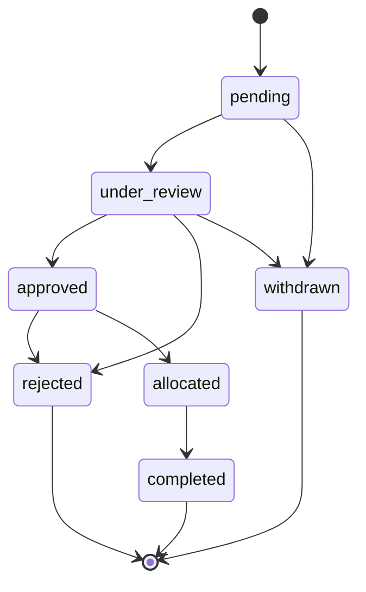
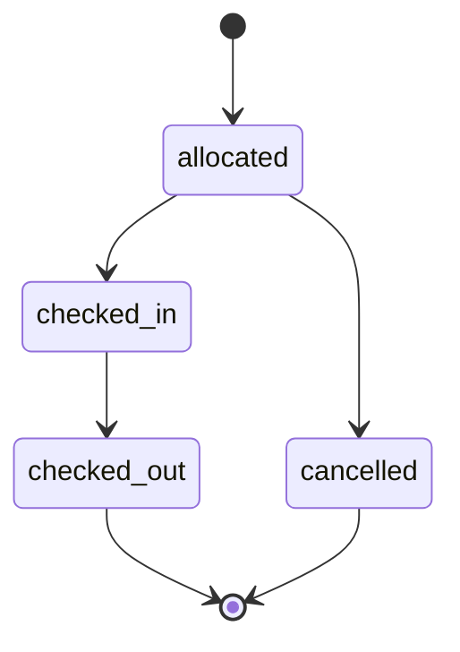
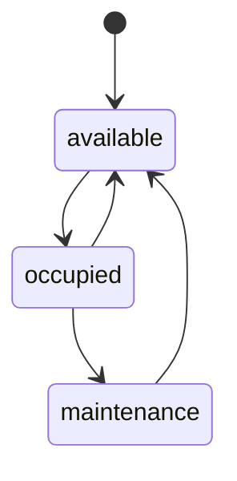
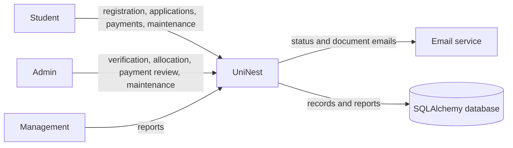
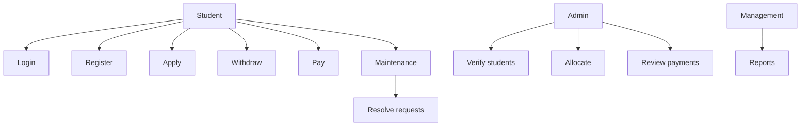
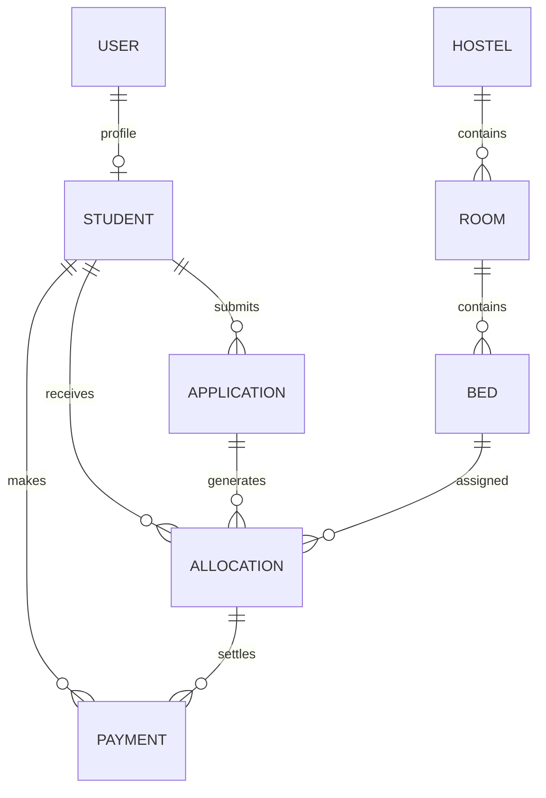

# UniNest — System Requirements Specification (SRS)

**Version:** 2.0  
**Status:** Final  
**Date:** 19 November 2026  
**Project:** Diploma in Information Technology  
**Student:** Victor Ndirangu (25/03338)

## 1. Introduction

### 1.1 Purpose
UniNest is a web-based university hostel management system that centralizes student registration and verification, hostel applications, room and bed allocation, payments, maintenance, notifications, reporting, and email communication.

### 1.2 Scope

**In scope**
- Student and staff accounts.
- Student registration, email verification, password reset, and account activation/deactivation.
- Hostel, room, bed, application, allocation, payment, maintenance, notification, and reporting workflows.
- In-app and privacy-safe email notifications.
- REST API and server-rendered web interface.
- CSV reporting and browser/API test journeys.

**Out of scope**
- Direct integration with the university ERP.
- Full payment gateway settlement; M-Pesa/Daraja integration is configuration-dependent and office confirmation remains available.
- SMS notifications.
- Accommodation fee structures and bursary rules.

### 1.3 Intended users
- Students use the system to register, apply, view allocations, record payments, request maintenance, and receive updates.
- Administrators manage users, hostels, applications, allocations, payments, maintenance, and reports.
- Management views permitted operational information and reports.
- Maintenance staff process maintenance requests.

## 2. Overall description

### 2.1 Existing process
Hostel records and applications are managed through manual forms and spreadsheets. This causes duplicate records, delayed verification, difficult payment reconciliation, limited status visibility, and weak audit trails.

### 2.2 Problems
- P1: Manual, inconsistent student registration.
- P2: Invalid or duplicated registration numbers.
- P3: Applications and allocations are difficult to track.
- P4: No centralized payment status or reconciliation.
- P5: Maintenance requests lack progress tracking.
- P6: Hostel occupancy information is not available in real time.
- P7: Sensitive manual records and weak role controls.
- P8: Students do not receive timely status updates.
- P9: Historical application and allocation records can be lost or orphaned.

### 2.3 Proposed system
UniNest provides shared data, role-based workflows, lifecycle state control, email and in-app updates, audit-oriented history, and operational reports.

### 2.4 Assumptions and constraints
- Users have internet access and a modern browser.
- The office provides a valid SMTP account for email delivery.
- The system requires Python 3.12 or later and SQLite for development or PostgreSQL for production.
- Email delivery failure SHALL NOT prevent an in-app notification or core transaction from completing.

## 3. Stakeholders and user roles

| Role | Responsibilities |
|---|---|
| Student | Register, maintain permitted profile data, apply, withdraw, pay, maintain assigned accommodation details, and receive updates |
| Administrator | Verify users, manage hostels, applications, allocations, payments, maintenance, and staff accounts |
| Management | View permitted operational reports and allocation information |
| Maintenance | Process assigned maintenance requests |

## 4. Functional requirements

### 4.1 Accounts and authentication

- FR-01: The system SHALL create student accounts with full name, email, password, registration number, programme, year of study, phone number, and gender. Registration number and email SHALL be unique.
- FR-02: Passwords SHALL contain at least eight characters and SHALL be stored as password hashes.
- FR-03: The system SHALL authenticate users with email and password.
- FR-04: The system SHALL support email verification and SHALL prevent unverified users from restricted workflows when email verification is enabled.
- FR-05: The system SHALL support password reset links through email.
- FR-06: The system SHALL throttle repeated failed logins and lock an account identifier after five failures for 15 minutes.
- FR-07: Students SHALL receive login alerts without revealing passwords or sensitive account details.
- FR-08: Administrators SHALL create administrator, management, and maintenance accounts as permitted.
- FR-09: Administrators SHALL deactivate and reactivate user accounts. Deactivated users SHALL NOT authenticate.
- FR-10: User passwords SHALL be changeable by the account owner through an authenticated password-change or reset workflow.
- FR-11: A verified student's registration number SHALL be locked or changing it SHALL automatically reset the verification status and erase the previous verification timestamp.
- FR-12: Student profile updates SHALL reject a registration number already assigned to another student.

### 4.2 Hostels and bed inventory

- FR-13: Administrators SHALL create, update, and inspect hostels with name, gender policy, location, description, image, and amenities.
- FR-14: Administrators SHALL create rooms and beds under hostels.
- FR-15: Beds SHALL use `available`, `occupied`, or `maintenance` states.
- FR-16: Administrators SHALL move a maintenance bed back to `available` only when it is not allocated.
- FR-17: The system SHALL block deletion of a hostel or room with occupied beds.
- FR-18: The system SHALL block deletion of hostels or rooms with application or allocation history.
- FR-19: Availability SHALL be visible to all authenticated roles using the same inventory rules.
- FR-20: A SHOULD warning SHALL be shown when an allocation mismatches a hostel gender policy; blocking the allocation remains the default policy.

### 4.3 Applications and allocations

- FR-21: Verified students SHALL submit one active application at a time.
- FR-22: Applications SHALL use `pending`, `under_review`, `approved`, `rejected`, `allocated`, `withdrawn`, or `completed` states.
- FR-23: Administrators SHALL approve, reject, or mark applications under review with notes.
- FR-24: Students SHALL withdraw `pending` or `under_review` applications.
- FR-25: Rejected or withdrawn applications SHALL allow the student to submit a subsequent application.
- FR-26: Administrators SHALL allocate an approved application only to an available bed.
- FR-27: Allocation SHALL include `allocated`, `checked_in`, `checked_out`, and `cancelled` states.
- FR-28: Check-in SHALL move an allocation from `allocated` to `checked_in`.
- FR-29: Check-out SHALL move the allocation to `checked_out`, complete the application, and make the bed available.
- FR-30: Cancellation SHALL free the bed, cancel the allocation, and return the application to `approved` for reallocation.
- FR-31: No student SHALL hold two concurrently active allocations.

### 4.4 Payments

- FR-32: Students SHALL record M-Pesa accommodation payments with amount, semester, allocation, and optional description.
- FR-33: Payments SHALL use `pending`, `confirmed`, or `failed` states.
- FR-34: Administrators SHALL confirm or reject pending payments.
- FR-35: Confirmation SHALL require a separately configured office sufficiency rule or full required amount. A positive or partial payment SHALL NOT automatically confirm accommodation unless the cumulative confirmed amount linked to the allocation meets that rule.
- FR-36: Only a confirmed payment linked to an active allocation SHALL set allocation `paid` and `accommodation_confirmed` flags.
- FR-37: A confirmed payment without an allocation SHALL remain a reconciliable payment record and SHALL NOT confirm accommodation.
- FR-38: Money SHALL be stored using decimal currency precision, never binary floating-point.
- FR-39: `confirmed_at` SHALL record confirmation or rejection processing; rejected payments SHALL also retain the processing office and timestamp in audit fields.

### 4.5 Maintenance

- FR-40: Students SHALL create maintenance requests linked to their allocated room.
- FR-41: Requests SHALL use `submitted`, `in_progress`, and `resolved` states.
- FR-42: Administrators or maintenance staff SHALL update the status and add a resolution note.
- FR-43: Resolved requests SHALL NOT reopen.

### 4.6 Notifications, email, and privacy

- FR-44: Every key account or accommodation status change SHALL create an in-app notification.
- FR-45: The system SHALL send an email for account creation, email verification, login, password reset, verification status, application status, allocation lifecycle, payment status, and maintenance status.
- FR-46: Email notifications SHALL exclude passwords, password-reset details after delivery disclosure, payment phone numbers, full financial amounts, and unnecessary personal details.
- FR-47: Email delivery failure SHALL be logged or silently tolerated without blocking the core account or status transaction.
- FR-48: Notifications SHALL be marked read individually or for the whole account.

### 4.7 Reporting

- FR-49: Administrators and management SHALL view occupancy, vacancies, payment totals by method/status/semester, allocation registers, and maintenance summaries.
- FR-50: Administrators and management SHALL download occupancy and allocation reports as CSV.
- FR-51: Management SHALL see only operational fields needed for oversight, not passwords, reset tokens, verification tokens, or unrelated personal contact history.

## 5. Non-functional requirements

| ID | Requirement | Priority | Acceptance measure |
|---|---|---|---|
| NFR-P1 | Search and page/API responses for a single-instance campus deployment SHALL complete within 2 seconds. | MUST | 95% of measured test requests complete under 2 seconds |
| NFR-P2 | Indexed queries SHALL cover email, registration number, foreign keys, status, and payment reference. | MUST | Database schema inspection confirms indexes |
| NFR-P3 | Student dashboard SHALL support up to 100 concurrent users. | SHOULD | Load test with 100 concurrent read sessions produces no error over 95% of requests |
| NFR-P4 | CSV export SHALL complete for a 10,000-record report within 5 seconds. | SHOULD | Timed export test passes |
| NFR-S1 | Passwords SHALL use bcrypt-class hashes. | MUST | No plaintext password storage; password hash inspection passes |
| NFR-S2 | API authentication SHALL use signed JWT credentials. | MUST | Invalid or expired tokens return 401 |
| NFR-S3 | Web sessions SHALL use HttpOnly cookies and SameSite=Lax. | MUST | Session cookie inspection passes |
| NFR-S4 | Web forms SHALL use CSRF tokens. | MUST | Request without a valid token is rejected |
| NFR-S5 | Login attempts SHALL use lockout throttling. | MUST | Five failures cause a 15-minute lockout |
| NFR-S6 | Protected routes SHALL enforce role checks. | MUST | 100% of tested unauthorized role requests are denied |
| NFR-S7 | Email bodies SHALL exclude sensitive fields. | MUST | 100% of sampled notification bodies pass privacy review |
| NFR-R1 | Successful status transitions SHALL persist atomically. | MUST | Failure injection leaves no partial status update |
| NFR-R2 | Application, allocation, payment, and historical records SHALL remain referentially consistent. | MUST | Integrity test finds no orphaned allocation history |
| NFR-R3 | Deletion SHALL require history-safe authorization. | MUST | Occupied or referenced records cannot be deleted |
| NFR-R4 | Account, application, allocation, payment, and maintenance records SHALL retain a retrievable audit trail. | SHOULD | Test data remains after status changes |
| NFR-U1 | Layout SHALL be mobile-friendly. | MUST | Core journeys pass 360 px and 768 px viewport checks |
| NFR-U2 | Controls SHALL have visible focus and semantic labels. | MUST | Keyboard navigation and accessibility scan pass |
| NFR-U3 | Validation messages SHALL be clear and role-neutral. | SHOULD | 95% of tested validation cases identify the missing or invalid field |
| NFR-U4 | Confirmation dialogs SHALL protect destructive actions. | SHOULD | Confirmed deletion/cancellation paths require user confirmation |
| NFR-U5 | UI text SHALL be understandable to first-time users. | SHOULD | Pilot-test 5 users achieve core task in under 3 minutes |
| NFR-AC1 | Primary contrast SHALL meet WCAG 2.1 AA. | MUST | Automated contrast scan passes |
| NFR-AC2 | Core workflows SHALL support keyboard-only use. | MUST | Keyboard-only test completes registration, application, and login |
| NFR-M1 | Business rules SHALL be isolated in services. | MUST | API and web routes delegate lifecycle rules to service modules |
| NFR-M2 | Database migrations SHALL support schema evolution. | SHOULD | Migration applies cleanly to a seeded development database |
| NFR-POR1 | Deployment SHALL require Python 3.12+, Flask, and pip dependencies. | MUST | Fresh environment setup completes through the documented command |

## 6. State models

### 6.1 Application lifecycle

### 6.2 Allocation lifecycle

### 6.3 Bed lifecycle

## 7. System models

### 7.1 Context diagram

### 7.2 Use-case overview

### 7.3 Entity relationship overview

## 8. Data requirements

### 8.1 Registration data
| Field | Required | Integrity |
|---|---|---|
| Full name | Yes | Non-empty |
| Email | Yes | Unique, valid format |
| Password | Yes | Minimum eight characters before hashing |
| Registration number | Yes | Unique; changing it resets verification |
| Programme | Yes | Text |
| Year of study | Yes | Integer 1–6 |
| Phone | Yes | Text |
| Gender | Yes | `male` or `female` |

### 8.2 Core entities
- Users: email, password hash, full name, role, active status, email verification status.
- Students: user link, registration number, programme, year, phone, gender, verification status.
- Hostels, rooms, and beds: names, policies, hierarchy, and bed state.
- Applications: student, hostel preference, room preference, notes, state, review fields.
- Allocations: student, bed, application, state, payment flags, review and lifecycle dates.
- Payments: student, allocation, decimal amount, method, semester, status, audit fields.
- Maintenance: allocation, student, title, description, priority, state, resolution note.
- Notifications: user, type, title, message, read state, created date.

## 9. Requirements traceability

| Problem | Requirements |
|---|---|
| P1 Registration inconsistency | FR-01, FR-11, FR-12 |
| P2 Duplicate or changed registration number | FR-11, FR-12, NFR-R2 |
| P3 Application and allocation tracking | FR-21–FR-31 |
| P4 Payment reconciliation | FR-32–FR-39 |
| P5 Maintenance tracking | FR-40–FR-43 |
| P6 Occupancy visibility | FR-13–FR-19, FR-49–FR-50 |
| P7 Security and role control | FR-03–FR-10, NFR-S1–NFR-S7 |
| P8 Student status awareness | FR-44–FR-48 |
| P9 Record integrity/history | FR-17–FR-18, FR-29–FR-30, NFR-R2–NFR-R4 |

### 9.1 Requirements-to-test matrix

| Requirements | Automated coverage |
|---|---|
| FR-01–FR-12 | `test_register_login_me`, email-policy tests, profile verification tests |
| FR-13–FR-20 | Hostel web/API tests and lifecycle tests |
| FR-21–FR-31 | Application, allocation, check-in/check-out tests |
| FR-32–FR-39 | Payment confirmation, partial-sufficiency, rejection-audit, and allocation-update tests |
| FR-40–FR-43 | Maintenance web/API tests |
| FR-44–FR-48 | Notification, login, signup, and privacy email tests |
| FR-49–FR-51 | Report and role-guard tests |
| NFR-S1–NFR-S7 | Authentication, role, password, lockout, CSRF, and privacy tests |

## 10. Requirements basis

The requirements are derived from the project proposal, the reviewed project scope, the final implementation, the system architecture, and the acceptance test suite. The proposal defines the need for centralized hostel administration, student applications, allocations, payments, maintenance, and reporting. The implementation and test results confirm the functional behaviour recorded in this SRS.

No interview transcripts or completed questionnaire responses were included with the project source files. Accordingly, this document does not assign sample respondent counts or invent interview findings. P1–P9 remain traceable to the documented process problems, system requirements, implementation modules, and acceptance cases below.

The approved evidence set for this submission is:

| Evidence source | Contribution |
|---|---|
| Revised proposal | Project purpose, scope, users, and system objectives |
| Implemented application | Account, hostel, application, allocation, payment, maintenance, notification, and report behaviour |
| Architecture document | Component boundaries and shared web/API service rules |
| User manual | Operational workflows and role responsibilities |
| Automated test suite | Registration, authentication, lifecycle, payment, report, role, and web journey verification |

## 10.1 Final implementation alignment

- Registration and maintenance-account passwords require at least eight characters; passwords are stored as hashes.
- Five failed login attempts trigger a fifteen-minute account identifier lockout.
- Web state-changing forms use session CSRF tokens and reject missing or mismatched tokens.
- Registration numbers are unique; changing a verified student's registration number resets hostel verification.
- Applications support pending, under-review, approved, rejected, allocated, withdrawn, and completed states.
- Cancellation restores the application to approved and frees the bed; check-out completes the application and frees the bed.
- Payment amounts use Numeric fields and two-decimal arithmetic.
- Accommodation confirmation uses an office-configured required amount and the sum of confirmed linked payments.
- Hostel and room deletion is blocked by occupied beds or application/allocation history.
- JWT authentication and role guards protect API routes; web routes enforce session roles.
- Management views exclude passwords, reset tokens, verification tokens, and unrelated contact history.

The automated suite covers API and web journeys and passed 17 tests using the isolated SQLite test configuration.

## 11. Appendices

### Appendix A — Interview guide
- How are hostel applications currently received and approved?
- How are verification records reconciled?
- How are payments and allocation confirmations recorded?
- How are maintenance requests tracked?
- What reports are required by management?

### Appendix B — Questionnaire
- Account and verification satisfaction.
- Application and allocation status difficulty.
- Payment reconciliation difficulty.
- Maintenance response and notification experience.
- Mobile usability and required reports.

### Appendix C — Data dictionary
See Section 8 and the SQLAlchemy models under `backend/app/models/`.

### Appendix D — Acceptance cases
- TC-01: Invalid or duplicate registration number is rejected.
- TC-02: Successful login clears lockout and sends a login alert.
- TC-03: Pending applications can be withdrawn and re-created.
- TC-04: Check-out closes the application and frees the bed.
- TC-05: Allocation cancellation restores the application to approved.
- TC-06: Any payment confirmation follows the office sufficiency rule.
- TC-07: Confirmed payments use decimal amounts and remain reconciled.
- TC-08: CSRF rejection denies a form missing or using a wrong token.
- TC-09: Management cannot view passwords or reset tokens.
- TC-10: Occupancy and allocation CSV reports are downloadable.

## 12. References

- ISO/IEC/IEEE 29148:2018, Systems and software engineering — Life cycle processes — Requirements engineering.
- OWASP Top 10 Web Application Security Risks.
- Flask 3.1 documentation.
- SQLAlchemy 2.x documentation.
- Flask-SQLAlchemy 3.1.1.
- Flask-Migrate 4.1.0.

## 13. Definitions

- **FR:** Functional requirement.
- **NFR:** Non-functional requirement.
- **SRS:** System Requirements Specification.
- **SHALL:** Mandatory requirement.
- **SHOULD:** Recommended requirement unless explicitly waived.
- **CSV:** Comma-separated values.
- **JWT:** JSON Web Token.
- **CSRF:** Cross-Site Request Forgery.
