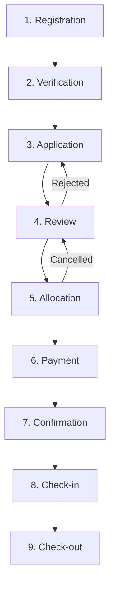
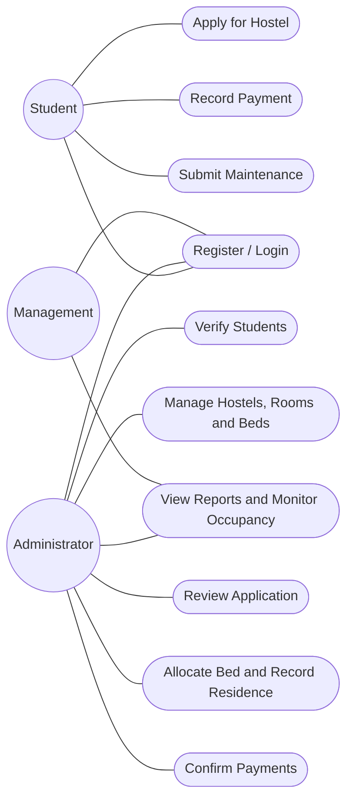
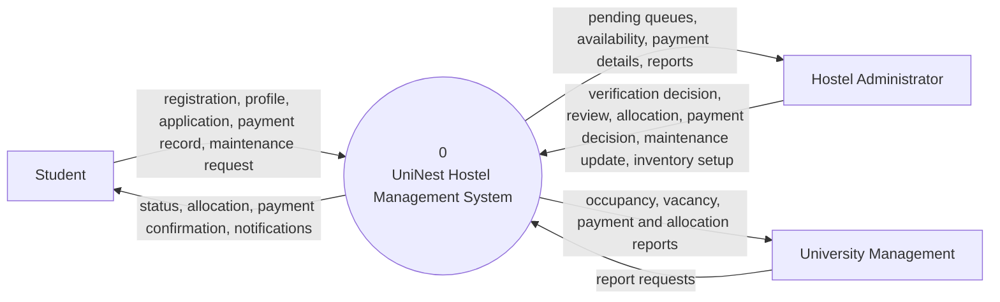
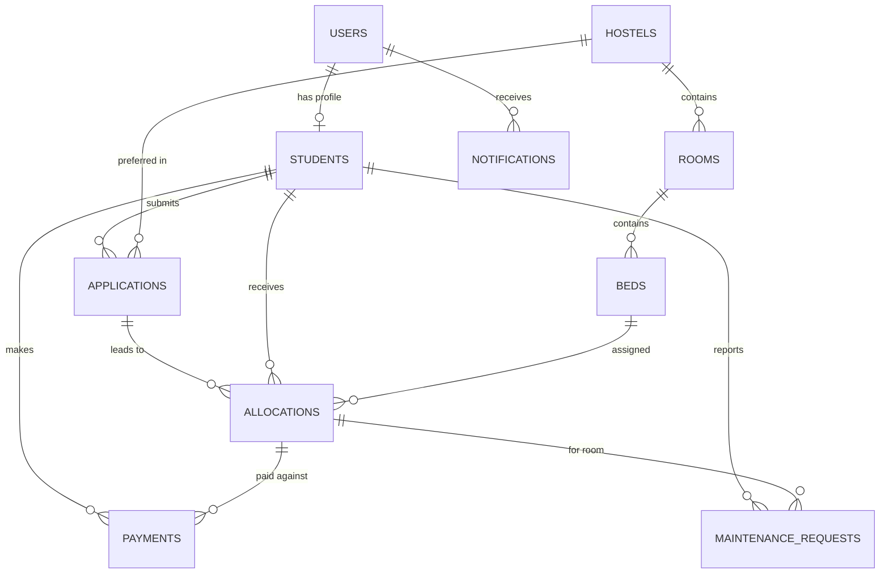
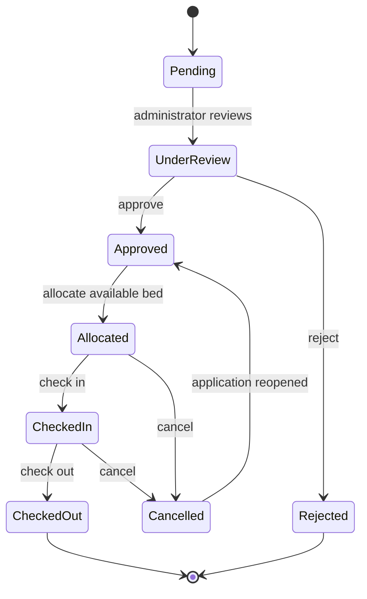

<!-- The cover page, declaration, document-control page and table of contents are generated
     by build_srs_pdf.py. Mermaid blocks marked with "%% figure:" are rendered as vector
     diagrams in the PDF. -->

# 1. Introduction

## 1.1 Purpose of the System

This System Requirements Specification (SRS) defines the complete set of requirements for **UniNest**, a centralized, web-based University Hostel Management System (UHMS). UniNest was designed and developed by Victor Ndirangu (Registration No. 25/03338) as the programming project for the Diploma in Information Technology (unit STU 701). The system replaces manual application forms, spreadsheets and physical registers with one coordinated platform covering student verification, hostel applications, room and bed allocation, payment records, maintenance requests, notifications and reporting.

The purpose of this document is to establish a single, verifiable agreement between the developer, the project supervisor, the hostel office and university management on what the system must do. It is the baseline for system design, implementation, testing and acceptance. The document is written for the following audiences:

- **Project supervisor and examiners** — to assess the completeness, correctness and feasibility of the requirements.
- **Hostel administrators** — to confirm that their operational needs are captured accurately.
- **University management** — to understand the information and reports the system provides.
- **Future developers and maintainers** — to understand the intended behaviour and constraints before modifying the system.

This SRS describes *what* UniNest must do. Implementation details, component structure and operating instructions are documented separately in `docs/ARCHITECTURE.md` and `deliverables/User_Manual.md`.

## 1.2 Scope of the System

UniNest covers the end-to-end hostel accommodation lifecycle for a single university campus: registration, enrolment verification, hostel application, application review, bed allocation, payment recording and confirmation, check-in, residence, maintenance and check-out. It provides two interfaces over one shared service layer: a server-rendered web interface for students and staff, and a JSON REST API secured with JSON Web Tokens (JWT).

**In scope:**

- Self-service student registration and profile management.
- Manual verification and un-verification of students by the hostel administrator.
- Management of hostels, rooms and beds, including live availability and maintenance status.
- Submission, review, approval and rejection of hostel applications.
- Bed allocation, check-in, check-out and cancellation of allocations.
- Recording and confirmation of accommodation payments (M-Pesa, bank, cash, card).
- Submission and progress tracking of maintenance requests.
- In-app notifications for every student-affecting state change.
- Operational reports and CSV exports for administrators and management.
- Role-based access control for students, administrators and management.
- A demonstration data seeder and an automated test suite for evaluation.

**Out of scope:**

- Online payment-gateway integration and automatic M-Pesa or bank reconciliation. Payment records are confirmed manually by the hostel office after checking the source statement or receipt.
- SMS, e-mail or push notifications. All notifications are in-app only.
- Integration with the university ERP, student registry, finance system or biometric access control. Enrolment verification is a manual administrative decision inside UniNest.
- Native Android or iOS applications. The system is a responsive web application.
- Offline operation, multi-campus tenancy, room-mate matching, visitor management, inventory/asset management and hostel fee structure configuration.
- Automated enforcement of hostel gender policy. The gender policy is recorded on each hostel for administrative guidance; the allocation decision remains with the hostel office.

The system boundary is one university campus, one shared database and the three user roles defined in Section 5. The public landing page displays live hostel availability read-only; all record-changing functions require authentication.

## 1.3 Intended Users

UniNest is used by the following user classes. Only the first three are system roles; the public visitor and the developer/support role are included for completeness.

| User class | Description | Interaction with UniNest | Access level |
|---|---|---|---|
| Student | A registered student seeking or occupying hostel accommodation | Registers, maintains a profile, applies for a hostel, tracks status, records payments, submits maintenance requests and reads notifications | Authenticated; own records only |
| Hostel Administrator | Hostel office staff who run the accommodation process | Verifies students, manages hostel inventory, reviews applications, allocates beds, confirms payments, resolves maintenance and produces reports | Authenticated; full administrative access |
| University Management | Deans, hostel committee members and senior administrators | Monitors occupancy, payment and allocation information and downloads reports | Authenticated; read-only |
| Public Visitor | A prospective student or parent browsing the landing page | Views hostel availability and general information | Unauthenticated; read-only public pages |
| Developer / Support | The developer maintaining the deployment | Runs the application, seeds data, performs migrations, backups and troubleshooting | Deployment-level access, not a system role |

The role of every account is stored on the user record and enforced on both the web interface and the REST API. A student cannot view another student's applications, allocations, payments or notifications. Management cannot modify accommodation records.

# 2. Overall Description

## 2.1 Existing System

Before UniNest, hostel accommodation at the university was administered through a paper-and-spreadsheet process. Students collected application forms from the hostel office, attached proof of enrolment and submitted the forms physically. Hostel staff entered applicant details into registers or spreadsheets and kept separate lists of rooms, beds and payments. Allocations were decided in meetings and written into an allocation book. Payment slips were matched to student files manually, while maintenance problems were reported verbally, by phone or through a notebook at the office.

The typical existing process is summarized below.

1. A student collects, completes and submits a paper hostel application with supporting documents.
2. Hostel staff manually check the student's enrolment details against a separate registry.
3. Applications are reviewed in batches and decisions are recorded in a register or spreadsheet.
4. Available rooms and beds are identified through physical checks and paper lists.
5. A bed is assigned by writing the student's name against the bed in the allocation book.
6. The student pays at the bank or by M-Pesa and presents a slip to the hostel office.
7. Staff match the slip to the student's file and mark the payment in a manual ledger.
8. Check-in, maintenance complaints and check-out are recorded in notebooks.
9. Management requests occupancy, vacancy and payment summaries, which are compiled manually.

## 2.2 Problems with the Existing System

The existing approach creates the following problems, which the proposed system must solve.

| ID | Problem | Effect on the hostel office and students |
|---|---|---|
| P1 | Data redundancy and duplication | The same student details are written on forms, registers, payment ledgers and allocation books, often with differences. |
| P2 | Slow retrieval of information | Finding a student's application, payment or room record requires searching physical files, especially during admission peaks. |
| P3 | Inconsistent and outdated records | Room, bed and payment status change faster than paper records can be updated, so decisions rely on stale information. |
| P4 | Allocation conflicts | Two staff members can assign the same bed or a student can hold more than one active allocation without a central check. |
| P5 | Delayed payment reconciliation | Payment slips are matched manually, so accommodation confirmation can lag behind the actual payment. |
| P6 | Poor visibility for students | Students must visit or call the office to learn the status of an application, allocation or maintenance request. |
| P7 | Heavy reporting burden | Occupancy, vacancy, payment and allocation reports must be compiled by hand for management. |
| P8 | Weak auditability and record security | Paper records can be lost, altered or accessed without trace, and there is no reliable history of who changed what. |
| P9 | Poor scalability during admissions | The manual process slows sharply when application volumes rise at the start of a semester. |

## 2.3 Proposed System

UniNest replaces the manual process with a centralized web application. Students register and apply online; hostel administrators work from live queues and dashboards; management views read-only reports. All state changes are recorded in one relational database, and the rules that govern applications, allocations and payments are enforced consistently in a shared service layer used by both the web interface and the REST API.

The system is organized into the following modules.

| Module | Main capabilities |
|---|---|
| M1 — Identity and access | Student self-registration, login, logout, JWT and session authentication, role enforcement |
| M2 — Student records | Student profile, enrolment details, verification and un-verification |
| M3 — Hostel inventory | Hostels, rooms and beds, availability, maintenance status and occupancy calculations |
| M4 — Applications | Application submission, duplicate prevention, review queue, approval and rejection |
| M5 — Allocation and residence | Bed allocation, check-in, check-out, cancellation and resident records |
| M6 — Payments | Payment recording, unique references, confirmation, rejection and accommodation confirmation |
| M7 — Maintenance | Request submission, priority, progress tracking, resolution notes and closure |
| M8 — Notifications | In-app notification inbox, unread badge and mark-as-read actions |
| M9 — Reporting | Dashboard summary, occupancy, vacancies, payments, allocation register and CSV exports |

The core business workflow is shown in Figure 2.1.

*Figure 2.1 — Core UniNest accommodation workflow.*

The main benefits of the proposed system are:

- **One source of truth** for students, hostels, rooms, beds, applications, allocations, payments and maintenance.
- **Enforced business rules** that prevent duplicate applications, double allocation of a bed and invalid status transitions.
- **Faster service** through dashboards, queues, status badges and instant searches.
- **Transparency** for students through status tracking and in-app notifications.
- **Reliable reporting** through live occupancy, vacancy, payment and allocation reports with CSV export.
- **Accountability** through recorded reviewer, allocator and confirmer identities and timestamps.
- **Low operating cost** because the system runs on Python and a single database with no proprietary licences or JavaScript build chain.

The technical stack is Flask 3 with server-rendered Jinja2 templates and a REST API secured by Flask-JWT-Extended, a service layer shared by both interfaces, SQLAlchemy ORM and SQLite in development with PostgreSQL supported for production. The architecture is documented in `docs/ARCHITECTURE.md`.

## 2.4 Assumptions and Constraints

### 2.4.1 Assumptions

- Students and staff have access to a modern web browser and an internet or campus network connection.
- Students provide accurate personal, enrolment and contact information, and they keep their profile up to date.
- The hostel office verifies enrolment details against the university registry manually before approving accommodation.
- The system serves one university campus and one accommodation cycle at a time.
- A student may hold only one active application and one active allocation at any time.
- Payment records are confirmed by the hostel office against M-Pesa statements, bank statements, receipts or cash records.
- Hostel administrators are trained on the system and use it during normal working hours.
- The in-app notification channel is sufficient for student communication; urgent issues are also handled by the office.
- Demo data (two hostels, twelve rooms, forty-eight beds and sample users) is used for evaluation and demonstration.
- The system operates in English, uses Kenyan Shillings (KSh) and follows East Africa Time (EAT).

### 2.4.2 Constraints

- **No payment-gateway integration.** UniNest records and confirms payments; it does not move money or query M-Pesa or bank APIs.
- **No automatic messaging.** Notifications are in-app only; there is no SMS, e-mail or push gateway.
- **No registry or ERP integration.** Student verification is performed by an administrator inside UniNest.
- **Web only.** The user interface is responsive but there is no native mobile application and no offline mode.
- **Single-instance deployment.** The target deployment is one application server and one database; high-availability clustering is outside the project.
- **SQLite in development.** SQLite is the default development database; PostgreSQL is recommended where concurrent write load is significant.
- **Python-only toolchain.** The application must run with Python 3.12+ and pip, with no Node.js or front-end build step.
- **Budget and schedule.** The project budget is KSh 4,900 and the schedule is approximately twenty-two weeks, as defined in the revised proposal.
- **Manual policy decisions.** The hostel gender policy, fee amounts and exceptional allocation decisions remain administrative judgements; the system records them but does not automate them.
- **Password policy.** The implemented minimum password length is six characters, which meets the project requirement but should be strengthened to at least eight characters in a production deployment.

# 3. Functional Requirements

This section states the functional requirements using the keyword **SHALL** for mandatory behaviour and **SHOULD** for recommended behaviour. Each requirement has a unique identifier (FR-nn), the primary actor and a MoSCoW priority: **M** (must have), **S** (should have) or **C** (could have). Requirements are grouped by module.

## 3.1 User Authentication

| ID | Requirement | Actor | Priority |
|---|---|---|---|
| FR-01 | The system SHALL allow a new student to register with full name, e-mail address, password, registration number, programme, year of study, phone number and gender. The role of a self-registered account SHALL be student. | Student | M |
| FR-02 | The system SHALL validate that the e-mail address contains an at sign, is stored in lower case, is unique across all users, and that the password is at least six characters long. | System | M |
| FR-03 | The system SHALL authenticate a registered user with an e-mail address and password and SHALL issue a JWT access token for the REST API and a signed session cookie for the web interface. | Student, Administrator, Management | M |
| FR-04 | The system SHALL expire API access tokens after twelve hours and SHALL provide a logout action that clears the web session. | System | M |
| FR-05 | The system SHALL enforce role-based authorization on every protected web route and API endpoint, allowing only student, administrator or management roles as appropriate. | System | M |
| FR-06 | The system SHALL return HTTP 401 for missing or invalid credentials and HTTP 403 for authenticated users who lack the required role, and SHALL NOT disclose whether an e-mail address exists during a failed login. | System | M |

## 3.2 User Management

| ID | Requirement | Actor | Priority |
|---|---|---|---|
| FR-07 | The system SHALL allow a student to view and update their own programme, year of study, phone number, gender and registration number. | Student | M |
| FR-08 | The system SHALL create every new student account with verification status unverified and SHALL record the verification timestamp when the account is verified. | System | M |
| FR-09 | The system SHALL allow an administrator to list and filter students by verification status and to verify or un-verify a student. | Administrator | M |
| FR-10 | The system SHALL prevent an unverified student from submitting a hostel application. | System | M |
| FR-11 | The system SHALL notify a student when their account is verified. | System | M |
| FR-12 | The system SHALL record the identity of the administrator who verifies a student, reviews an application, allocates a bed, confirms a payment or resolves a maintenance request, together with the relevant timestamp. | System | M |
| FR-13 | The system SHALL allow management users to view student, hostel, allocation, payment and report information in read-only form and SHALL reject management attempts to modify records. | Management | M |

## 3.3 Hostel, Room and Bed Management

| ID | Requirement | Actor | Priority |
|---|---|---|---|
| FR-14 | The system SHALL allow an administrator to create, update and delete a hostel with a unique name, a gender policy of male, female or mixed, a location and a description. | Administrator | M |
| FR-15 | The system SHALL reject a hostel name that already exists and a gender policy outside the allowed values. | System | M |
| FR-16 | The system SHALL allow an administrator to create, update and delete rooms within a hostel, recording room number, floor and room type (shared or single). Room numbers SHALL be unique within a hostel. | Administrator | M |
| FR-17 | The system SHALL optionally create between one and thirty automatically numbered beds when a room is created. | Administrator | M |
| FR-18 | The system SHALL allow an administrator to add between one and thirty beds to an existing room and to rename a bed. | Administrator | M |
| FR-19 | The system SHALL allow an administrator to mark a bed available or under maintenance, and SHALL prevent changing or deleting an occupied bed until its allocation is released. | Administrator | M |
| FR-20 | The system SHALL prevent deletion of a hostel or room that contains occupied beds. | System | M |
| FR-21 | The system SHALL calculate and display, for every hostel and room, the total, occupied, available and maintenance bed counts and the occupancy rate. | System | M |
| FR-22 | The system SHALL display live hostel availability on the public landing page and SHALL provide an availability overview to authenticated users. | Public, all roles | M |

## 3.4 Application Management

| ID | Requirement | Actor | Priority |
|---|---|---|---|
| FR-23 | The system SHALL allow a verified student to submit a hostel application with an optional preferred hostel, a room preference of any, single or shared, and free-text notes. | Student | M |
| FR-24 | The system SHALL reject a new application when the student already has an application in pending, under_review, approved or allocated status. | System | M |
| FR-25 | The system SHALL reject a room preference outside the values any, single or shared, and a preferred hostel that does not exist. | System | M |
| FR-26 | The system SHALL allow an administrator and management user to list applications and filter them by status, and SHALL allow the owning student to view only their own applications. | Student, Administrator, Management | M |
| FR-27 | The system SHALL allow an administrator to move an application to under_review, approve it or reject it, optionally recording review notes, the reviewer and the review timestamp. | Administrator | M |
| FR-28 | The system SHALL prevent review of an application that is already allocated and SHALL prevent a no-change transition to the current status. | System | M |
| FR-29 | The system SHALL notify the student when an application is placed under review, approved or rejected, including the review notes when a rejection note is supplied. | System | M |

## 3.5 Allocation and Residence Management

| ID | Requirement | Actor | Priority |
|---|---|---|---|
| FR-30 | The system SHALL allow an administrator to allocate an approved application to a bed that is currently available. | Administrator | M |
| FR-31 | The system SHALL enforce that a bed has at most one active allocation and that a student has at most one active allocation at any time. | System | M |
| FR-32 | The system SHALL reject allocation when the application is not approved, the bed is not available, the application already has an active allocation or the student already holds an active allocation. | System | M |
| FR-33 | On successful allocation the system SHALL mark the bed occupied, mark the application allocated, record the allocating administrator and timestamp, and notify the student with the hostel, room and bed details. | System | M |
| FR-34 | The system SHALL allow an administrator to record check-in for an allocation in allocated status, setting the check-in date and moving the allocation to checked_in. | Administrator | M |
| FR-35 | The system SHALL allow an administrator to record check-out for an allocation in checked_in status, setting the check-out date, moving the allocation to checked_out and returning the bed to available. | Administrator | M |
| FR-36 | The system SHALL allow an administrator to cancel an allocation that is not already checked out, returning the bed to available, returning the linked application to approved and notifying the student. | Administrator | M |
| FR-37 | The system SHALL allow students to view their own allocation details and SHALL allow administrators and management to view and filter all allocations. | Student, Administrator, Management | M |
| FR-38 | The system SHALL record the paid and accommodation_confirmed flags on an allocation and SHALL display them to the student and staff. | System | M |

## 3.6 Payment Management

| ID | Requirement | Actor | Priority |
|---|---|---|---|
| FR-39 | The system SHALL allow a student to record a payment with a positive amount, a method of mpesa, bank, cash or card, an optional allocation belonging to that student, a semester and an optional description. | Student | M |
| FR-40 | The system SHALL allow an administrator to record a payment on behalf of a student by supplying a student identifier or an allocation identifier. | Administrator | M |
| FR-41 | The system SHALL generate a unique payment reference in the form UNI- followed by ten hexadecimal characters, SHALL default the currency to KSh and SHALL create the payment in pending status. | System | M |
| FR-42 | The system SHALL reject a non-positive amount, an invalid payment method and an allocation that does not belong to the student. | System | M |
| FR-43 | The system SHALL allow a student to view their own payment history and status, and SHALL allow staff to view and filter all payments. | Student, Administrator, Management | M |
| FR-44 | The system SHALL allow an administrator to confirm a pending payment, recording the confirming administrator and timestamp, and SHALL mark a linked active allocation as paid and accommodation_confirmed. | Administrator | M |
| FR-45 | The system SHALL allow an administrator to mark a pending payment as failed or not accepted and SHALL notify the student. | Administrator | M |
| FR-46 | The system SHALL prevent confirmation or failure of a payment that is not pending and SHALL notify the student when a payment is confirmed. | System | M |
| FR-47 | The system SHALL NOT store card numbers, bank credentials or mobile-money PINs; it SHALL store only the payment method, reference, amount, semester, description and status. | System | M |

## 3.7 Maintenance Management

| ID | Requirement | Actor | Priority |
|---|---|---|---|
| FR-48 | The system SHALL allow a student to submit a maintenance request with a required title, an optional description and a priority of low, medium or high. | Student | M |
| FR-49 | The system SHALL link a maintenance request to a selected allocation owned by the student or, when no allocation is supplied, to the student's most recent allocation. | System | M |
| FR-50 | The system SHALL reject an empty title, an invalid priority and an allocation that does not belong to the student. | System | M |
| FR-51 | The system SHALL allow students to view their own requests and administrators and management to view and filter all requests. | Student, Administrator, Management | M |
| FR-52 | The system SHALL allow an administrator to move a request from submitted to in_progress and to resolved, optionally recording a resolution note, the resolver and the resolution timestamp. | Administrator | M |
| FR-53 | The system SHALL prevent a resolved maintenance request from being reopened and SHALL notify the student at each status change. | System | M |
| FR-54 | The system SHALL include the linked hostel and room in a maintenance request view when an allocation is present. | System | M |

## 3.8 Notifications

| ID | Requirement | Actor | Priority |
|---|---|---|---|
| FR-55 | The system SHALL create an in-app notification for the affected student when an account is verified, an application is reviewed, an allocation is created, cancelled, checked in or checked out, a payment is confirmed or failed, or a maintenance request changes status. | System | M |
| FR-56 | The system SHALL allow a user to view their own notifications in reverse chronological order with the unread count. | Student, Administrator, Management | M |
| FR-57 | The system SHALL allow a user to mark a single notification or all notifications as read. | Student, Administrator, Management | M |
| FR-58 | The system SHALL prevent a user from viewing or modifying another user's notifications. | System | M |

## 3.9 Report Generation

| ID | Requirement | Actor | Priority |
|---|---|---|---|
| FR-59 | The system SHALL provide administrators and management with a dashboard summary containing occupancy, active allocations, application counts and confirmed and pending payment totals. | Administrator, Management | M |
| FR-60 | The system SHALL provide an occupancy report showing, per hostel, the number of rooms, total beds, occupied beds, available beds, beds under maintenance and occupancy rate. | Administrator, Management | M |
| FR-61 | The system SHALL provide a vacancy report showing available beds grouped by hostel and room, including the bed numbers and total free beds. | Administrator, Management | M |
| FR-62 | The system SHALL provide a payments report grouped by method, status and semester, with transaction counts and totals. | Administrator, Management | M |
| FR-63 | The system SHALL provide an allocation register listing the student, registration number, hostel, room, bed, allocation status, payment flag and allocation date. | Administrator, Management | M |
| FR-64 | The system SHALL allow administrators and management to download the occupancy report and the allocation register as CSV files with column headers. | Administrator, Management | M |
| FR-65 | The system SHALL deny students access to management reports and CSV exports. | System | M |
| FR-66 | The system SHOULD allow report data to be filtered by the criteria exposed by the report endpoint, such as payment status or allocation status. | Administrator, Management | S |

# 4. Non-Functional Requirements

The non-functional requirements define the quality attributes of UniNest. Each requirement is measurable and can be verified during testing or deployment review.

## 4.1 Performance Requirements

| ID | Requirement |
|---|---|
| NFR-P1 | A typical page load or API request SHALL complete within one second for the expected campus data volume of up to 5,000 students, 2,000 beds and 20,000 payment records on the recommended hardware in Section 6.1. |
| NFR-P2 | Search, filtering and dashboard summary requests SHALL complete within three seconds under a peak load of 100 concurrent authenticated users. |
| NFR-P3 | CSV export of up to 10,000 rows SHALL complete within five seconds. |
| NFR-P4 | The system SHALL use indexed lookups for e-mail addresses, registration numbers, foreign keys, statuses and notification read flags, and SHALL avoid unbounded full-table scans in normal request paths. |
| NFR-P5 | Application start-up SHALL complete within ten seconds on the recommended server so that routine restarts are quick. |

## 4.2 Security Requirements

| ID | Requirement |
|---|---|
| NFR-S1 | Passwords SHALL be stored only as salted one-way hashes produced by the Werkzeug password-hashing utility; plaintext passwords SHALL never be stored, logged or returned by any endpoint. |
| NFR-S2 | The REST API SHALL use signed JWT access tokens with a twelve-hour expiry, and the web interface SHALL use signed session cookies marked HttpOnly and SameSite=Lax. |
| NFR-S3 | Every protected route SHALL enforce authentication and role authorization on the server side; client-side hiding of controls SHALL NOT be treated as a security control. |
| NFR-S4 | All user input SHALL be validated on the server, status and enumeration fields SHALL be restricted to documented values, and database access SHALL use the SQLAlchemy ORM or parameterized queries to prevent SQL injection. |
| NFR-S5 | Failed login responses SHALL use a generic invalid-credentials message and SHALL NOT reveal whether an e-mail address is registered. |
| NFR-S6 | Secrets and database credentials SHALL be supplied through environment variables (UNINEST_SECRET_KEY, UNINEST_JWT_KEY and UNINEST_DB_URI) and the development defaults SHALL be replaced before production use. |
| NFR-S7 | Production deployments SHALL serve the application over HTTPS through a reverse proxy, and the database account used by the application SHALL have only the privileges it requires. |
| NFR-S8 | The system SHALL record reviewer, allocator, payment confirmer and maintenance resolver identities with timestamps to support accountability. |
| NFR-S9 | The system SHALL NOT store payment-card numbers, CVVs, mobile-money PINs or bank credentials. |
| NFR-S10 | The implementation SHALL follow the OWASP Top Ten mitigation guidance for authentication, access control, injection, misconfiguration and sensitive-data exposure. |

## 4.3 Reliability Requirements

| ID | Requirement |
|---|---|
| NFR-R1 | The system SHALL be available for at least 99 percent of scheduled service hours per calendar month, excluding announced maintenance. |
| NFR-R2 | Multi-record state changes such as allocation, payment confirmation and check-out SHALL execute within a single database transaction so that partial updates cannot persist. |
| NFR-R3 | The system SHALL enforce the invariants that a bed has at most one active allocation, a student has at most one active allocation and a student has at most one active application. |
| NFR-R4 | Foreign-key relationships SHALL preserve referential integrity and the system SHALL NOT leave orphan applications, allocations, payments or maintenance records. |
| NFR-R5 | The database SHALL be backed up at least once per day, and a restore procedure SHALL be documented and tested before deployment sign-off. |
| NFR-R6 | After a server restart, the system SHALL recover without loss of committed records, with a recovery time objective of one hour and a recovery point objective of twenty-four hours. |
| NFR-R7 | Unexpected errors SHALL be logged for the administrator and presented to users as a safe JSON error or a flashed web message; stack traces and internal details SHALL NOT be exposed. |

## 4.4 Usability Requirements

| ID | Requirement |
|---|---|
| NFR-U1 | The web interface SHALL be responsive and usable on screen widths from 360 pixels on a phone to 1920 pixels on a desktop. |
| NFR-U2 | A student SHALL be able to reach the application, payment, maintenance and notification functions within three clicks of the student dashboard, and an administrator SHALL reach the verification, application, allocation and payment queues within three clicks of the administrator dashboard. |
| NFR-U3 | Statuses SHALL be displayed with consistent text labels and colour-coded badges, and destructive actions SHALL require confirmation in the web interface. |
| NFR-U4 | Forms SHALL provide labels, required-field indicators and clear validation feedback, and errors SHALL explain how to correct the problem. |
| NFR-U5 | The interface SHALL remain usable on low-end devices by using server-rendered HTML and CSS with minimal JavaScript and no third-party JavaScript framework. |
| NFR-U6 | Dates, currency, status names and page terminology SHALL be consistent throughout the web interface and API responses. |

## 4.5 Availability Requirements

| ID | Requirement |
|---|---|
| NFR-A1 | The system SHALL be available during normal hostel-office hours, 08:00 to 18:00 East Africa Time, Monday to Friday, and SHOULD remain available for extended hours during application and admission periods. |
| NFR-A2 | Planned maintenance SHALL be scheduled outside service hours and communicated to users in advance. |
| NFR-A3 | A single-node deployment SHALL be acceptable for the campus workload, provided that a documented restart and monitoring procedure is in place. |
| NFR-A4 | When the database is unavailable, the system SHALL fail gracefully with a clear error message and SHALL NOT corrupt existing records. |

## 4.6 Maintainability, Portability and Testability

| ID | Requirement |
|---|---|
| NFR-M1 | Business rules SHALL be isolated in the service layer so that the web interface and REST API remain thin and consistent. |
| NFR-M2 | Database schema changes SHALL be managed through Flask-Migrate migrations rather than ad-hoc manual changes. |
| NFR-M3 | Configuration SHALL be externalized through environment variables, with safe development defaults and documented production overrides. |
| NFR-M4 | The application SHALL run on Python 3.12 or later with pip-installed dependencies and SHALL NOT require Node.js or a front-end build step. |
| NFR-M5 | SQLite SHALL be supported as the default development and demonstration database, and PostgreSQL SHALL be supported for production deployments without code changes. |
| NFR-M6 | The repository SHALL include automated tests, architecture documentation, a user manual and seed data so that a new developer can run and verify the system. |

## 4.7 Accessibility Requirements

| ID | Requirement |
|---|---|
| NFR-AC1 | Pages SHALL use semantic HTML5 landmarks, labelled form controls and a logical tab order, and all interactive controls SHALL be keyboard operable. |
| NFR-AC2 | Colour contrast SHALL aim to meet WCAG 2.1 AA for text and essential interface elements. |
| NFR-AC3 | Status SHALL NOT be conveyed by colour alone; every badge SHALL include a readable text label. |

# 5. User Requirements

This section describes what the users need from UniNest, independent of implementation. The user stories were derived from the project proposal, interviews with hostel staff and the student questionnaire in Appendix B. Each story includes acceptance criteria that can be demonstrated during evaluation.

## 5.1 User Classes and Characteristics

| User class | Characteristics | Frequency of use | Main needs |
|---|---|---|---|
| Student | Registered student, basic computer and smartphone skills, often off-campus | High during application and payment periods; low during residence | Apply quickly, know the status, receive clear notifications, pay and report problems without visiting the office |
| Hostel Administrator | Hostel office staff, trained on the system, handles high volumes at admission time | Daily during working hours | Verify students, see live availability, process queues quickly, prevent mistakes and produce reports |
| University Management | Senior staff, occasional users, interested in summary information | Weekly or on request | Trustworthy occupancy, vacancy, payment and allocation information that can be exported |
| Public Visitor | Prospective student or parent, unauthenticated | Occasional | See whether accommodation is available and understand how to apply |

## 5.2 Student User Stories

| ID | User story | Acceptance criteria |
|---|---|---|
| US-S1 | As a student, I want to create an account online so that I can apply for accommodation without collecting paper forms. | Registration accepts the required details, rejects duplicate e-mail addresses and creates an unverified student account. |
| US-S2 | As a student, I want to complete my profile so that the hostel office has accurate enrolment and contact information. | The student can view and update programme, year, phone, gender and registration number. |
| US-S3 | As a student, I want to apply for a hostel and state my preferences so that I can be considered for suitable accommodation. | A verified student with no active application can submit one application with an optional hostel and room preference and receives a pending status. |
| US-S4 | As a student, I want to track my application so that I know whether I need to take any action. | The dashboard shows pending, under review, approved, rejected or allocated status with the latest review information. |
| US-S5 | As a student, I want to see my allocated hostel, room and bed so that I know where to report. | After allocation, the student sees the hostel, room, bed, allocation status and payment flags. |
| US-S6 | As a student, I want to record my payment and see when it is confirmed so that my accommodation is confirmed. | The student records amount, method, semester and allocation, receives a unique reference, and sees the payment move from pending to confirmed or failed. |
| US-S7 | As a student, I want to report a maintenance problem and follow its progress so that it can be fixed. | The student submits a title, description and priority, and sees the request move from submitted to in progress to resolved with a resolution note. |
| US-S8 | As a student, I want to receive notifications about decisions and changes so that I do not have to keep visiting the office. | Verification, application, allocation, payment and maintenance changes appear in the notification inbox with an unread count. |
| US-S9 | As a student, I want to see hostel availability before applying so that I can make a realistic choice. | The landing page and availability page show live total, occupied, available and maintenance bed counts per hostel. |

## 5.3 Administrator User Stories

| ID | User story | Acceptance criteria |
|---|---|---|
| US-A1 | As an administrator, I want to verify students so that only eligible students are allocated accommodation. | The administrator can filter unverified students, verify or un-verify one, and the student is notified. |
| US-A2 | As an administrator, I want to create hostels, rooms and beds so that the system reflects the real hostel inventory. | Hostel, room and bed records can be created, updated and deleted with uniqueness and occupied-bed protection rules enforced. |
| US-A3 | As an administrator, I want to see live availability so that I can allocate beds confidently. | Every hostel and room shows total, occupied, available and maintenance counts and occupancy percentage. |
| US-A4 | As an administrator, I want to review applications in a queue so that I can process them efficiently. | Applications can be filtered by status, moved to under review, approved or rejected with notes, and the student is notified. |
| US-A5 | As an administrator, I want to allocate an approved application to a free bed so that the student receives accommodation. | Only an approved application and an available bed can be selected; the bed becomes occupied and the student is notified. |
| US-A6 | As an administrator, I want to record check-in, check-out and cancellation so that the residence record stays accurate. | Check-in, check-out and cancellation follow the allowed state transitions and free the bed when appropriate. |
| US-A7 | As an administrator, I want to confirm or reject payments so that accommodation is confirmed only for genuine payments. | Only pending payments can be confirmed or failed; confirmation sets the allocation paid and accommodation confirmed and notifies the student. |
| US-A8 | As an administrator, I want to manage maintenance requests so that student problems are resolved and recorded. | Requests can be started and resolved with a note, and resolved requests cannot be reopened. |
| US-A9 | As an administrator, I want reports and CSV exports so that I can answer management questions and keep records. | Occupancy, vacancies, payments and allocation register are available, and occupancy and allocations can be downloaded as CSV. |
| US-A10 | As an administrator, I want a dashboard of pending work so that I can prioritise my day. | The dashboard shows pending applications, students awaiting verification, occupancy and pending payments with links to the queues. |

## 5.4 Management User Stories

| ID | User story | Acceptance criteria |
|---|---|---|
| US-M1 | As a management user, I want an occupancy overview so that I can monitor the use of hostel space. | The management dashboard shows total, occupied, available and maintenance beds, occupancy rate and active allocations. |
| US-M2 | As a management user, I want payment and allocation reports so that I can review financial and accommodation performance. | Reports show payment totals by method, status and semester, and an allocation register with student and bed details. |
| US-M3 | As a management user, I want read-only access so that monitoring does not interfere with hostel operations. | Management can view dashboards and reports but cannot verify students, change inventory, allocate beds, confirm payments or resolve maintenance. |
| US-M4 | As a management user, I want CSV exports so that I can analyse data in a spreadsheet. | Occupancy and allocation reports download as CSV files with column headers. |

# 6. System Requirements

## 6.1 Hardware Requirements

The following hardware is required to run and use UniNest. The minimum configuration supports demonstration and small-scale use; the recommended configuration supports a full campus workload with PostgreSQL.

| Component | Minimum | Recommended |
|---|---|---|
| Server processor | 2 cores at 2.0 GHz | 4 cores at 2.5 GHz or better |
| Server memory | 4 GB RAM | 8 GB RAM or more |
| Server storage | 40 GB SSD | 100 GB SSD with room for database backups |
| Server network | 10 Mbps wired or campus LAN | 100 Mbps campus LAN |
| Power protection | Surge protector | Uninterruptible power supply for the server and network equipment |
| Client device | Smartphone, tablet or laptop with 2 GB RAM | Laptop or desktop with 4 GB RAM or more |
| Client display | 360 pixel width | 1366 by 768 pixels or higher |
| Client network | 1 Mbps connection | 5 Mbps or better |
| Backup storage | External drive or network share | Off-site or cloud backup storage with retention |

## 6.2 Software Requirements

| Category | Software | Version or notes |
|---|---|---|
| Server operating system | Ubuntu Server, Debian or Windows | Ubuntu 22.04 LTS or later, Debian 12 or later, Windows 10 or 11 |
| Programming language | Python | 3.12 or later |
| Web framework | Flask | 3.1.3 |
| ORM and migrations | Flask-SQLAlchemy, Flask-Migrate | 3.1.1 and 4.1.0 |
| Authentication | Flask-JWT-Extended | 4.7.4, twelve-hour access tokens |
| Cross-origin support | Flask-CORS | 6.0.5 |
| Password hashing | Werkzeug security utilities | Supplied with Flask |
| Development database | SQLite | 3.35 or later |
| Production database | PostgreSQL | 14 or later, recommended for campus deployment |
| Web server | Gunicorn or Waitress | Gunicorn on Linux, Waitress on Windows |
| Reverse proxy and TLS | Nginx or Apache | Optional for development; required for HTTPS in production |
| Testing | pytest | 9.1.1 |
| Web browser | Chrome, Edge, Firefox or Safari | Latest two stable versions |
| Development tools | Git, Visual Studio Code or PyCharm, Python venv | Used for source control, editing and isolated dependencies |
| Documentation format | Markdown | README, architecture, SRS and user manual |

## 6.3 Network and Deployment Requirements

- The application server SHALL listen on a configurable port (5001 in development) and SHALL be placed behind a reverse proxy that terminates TLS in production.
- The server SHALL have a stable campus network address or domain name and SHALL be reachable by student and staff devices.
- The database SHALL reside on the same host for the single-node deployment, or on a protected database host for a larger deployment.
- The following environment variables SHALL be configured: UNINEST_DB_URI, UNINEST_SECRET_KEY and UNINEST_JWT_KEY.
- The production database account SHALL have only the privileges required by the application and SHALL NOT be a superuser.
- Outbound internet access SHALL NOT be required for normal operation, because there is no external service integration.
- The deployment SHALL include a daily backup job and a documented restore procedure.

# 7. System Models

This section presents the system models required by the SRS guidelines: the use case diagram, the context diagram and the entity relationship diagram. A state model is added to clarify the lifecycle rules that the functional requirements enforce. The diagrams are also maintained as Mermaid source in this document; the PDF renders them as vector figures.

## 7.1 Use Case Diagram

Figure 7.1 shows the main actors and the use cases they perform. Authentication is common to all actors and is shown once for clarity.

*Figure 7.1 — Use case diagram of UniNest.*

| Use case | Primary actor | Supporting requirements |
|---|---|---|
| Register / Login | Student, Administrator, Management | FR-01 to FR-06 |
| Apply for Hostel | Student | FR-23 to FR-29 |
| Record Payment | Student | FR-39 to FR-47 |
| Submit Maintenance | Student | FR-48 to FR-54 |
| Verify Students | Administrator | FR-07 to FR-13 |
| Manage Hostels, Rooms and Beds | Administrator | FR-14 to FR-22 |
| Review Application | Administrator | FR-26 to FR-29 |
| Allocate Bed and Record Residence | Administrator | FR-30 to FR-38 |
| Confirm Payments | Administrator | FR-43 to FR-47 |
| View Reports and Monitor Occupancy | Administrator, Management | FR-59 to FR-66 |

## 7.2 Context Diagram

Figure 7.2 shows UniNest as a single process interacting with the external entities that supply or receive data. There are no automated external systems; verification and payment confirmation are manual activities performed by the administrator.

*Figure 7.2 — Context diagram (level-0 data flow) of UniNest.*

| External entity | Data supplied to UniNest | Data received from UniNest |
|---|---|---|
| Student | Registration details, profile updates, applications, payment records, maintenance requests | Application and allocation status, payment status, notifications, availability information |
| Hostel Administrator | Verification decisions, application reviews, allocations, check-in and check-out, payment decisions, hostel inventory, maintenance updates | Pending work queues, live availability, applicant and resident details, payment details, reports |
| University Management | Report requests | Occupancy, vacancy, payment and allocation reports and CSV exports |

## 7.3 Entity Relationship Diagram

Figure 7.3 shows the logical data model. Primary keys are marked PK and foreign keys FK; the full field-level definition is given in the data dictionary in Appendix E. The diagram is rendered on a landscape page for readability.

*Figure 7.3 — Entity relationship diagram of UniNest.*

| Relationship | Cardinality | Description |
|---|---|---|
| users to students | One to zero or one | A student account has exactly one student profile; staff accounts have none. |
| hostels to rooms | One to many | A hostel contains many rooms; each room belongs to one hostel. |
| rooms to beds | One to many | A room contains many beds; each bed belongs to one room. |
| students to applications | One to many | A student may submit many applications over time, but only one may be active. |
| hostels to applications | One to many | An application may name a preferred hostel. |
| applications to allocations | One to many | An approved application may lead to an allocation; cancelled allocations can return it to approved. |
| students to allocations | One to many | A student accumulates allocation history but holds at most one active allocation. |
| beds to allocations | One to many | A bed has allocation history but at most one active allocation. |
| students to payments | One to many | A student may record several payments over time. |
| allocations to payments | One to many | A payment may be linked to an allocation. |
| students to maintenance_requests | One to many | A student may report several maintenance problems. |
| allocations to maintenance_requests | One to many | A maintenance request may reference the allocation and room it concerns. |
| users to notifications | One to many | A user receives many notifications. |

## 7.4 State Models

Figure 7.4 shows the application and allocation lifecycle. A rejected application ends its active life; a cancelled allocation returns the application to approved so that a new allocation can be made. Payment and maintenance states are defined in the table that follows.

*Figure 7.4 — Application and allocation state model.*

| Object | States | Allowed transitions | Rules |
|---|---|---|---|
| Student verification | unverified, verified | unverified to verified; verified to unverified | Admin only; unverified students cannot apply |
| Application | pending, under_review, approved, rejected, allocated | pending to under_review; under_review to approved or rejected; approved to allocated | One active application per student; allocated applications cannot be reviewed |
| Allocation | allocated, checked_in, checked_out, cancelled | allocated to checked_in or cancelled; checked_in to checked_out or cancelled | Check-out frees the bed; cancellation frees the bed and reopens the application |
| Payment | pending, confirmed, failed | pending to confirmed or failed | Only pending payments can be decided; confirmation sets allocation paid and accommodation_confirmed |
| Maintenance | submitted, in_progress, resolved | submitted to in_progress to resolved | Resolved requests cannot be reopened |
| Bed | available, occupied, maintenance | available to maintenance; available to occupied; occupied to available after release | Occupied beds cannot be changed or deleted |

| Invariant | Enforcement |
|---|---|
| A bed has at most one active allocation | Allocation service checks the bed status and active allocations in one transaction |
| A student has at most one active allocation | Allocation service checks active allocations for the student |
| A student has at most one active application | Application service checks pending, under_review, approved and allocated statuses |
| A hostel or room with occupied beds cannot be deleted | Hostel service checks the occupied-bed count before deletion |
| A resolved maintenance request cannot be reopened | Maintenance service rejects transitions away from resolved |

# 8. Data Requirements

## 8.1 Data Inputs

The following inputs are captured by the system. All fields are validated on the server; required fields are indicated.

| Input form | Fields | Source | Validation |
|---|---|---|---|
| Student registration | Full name, e-mail, password, registration number, programme, year of study, phone, gender | Student | E-mail format and uniqueness; password at least six characters; required e-mail, password and name |
| Login | E-mail, password | All users | Required fields; generic invalid-credentials response |
| Student profile | Programme, year of study, phone, gender, registration number | Student | Student role only; own profile only |
| Student verification | Verify or un-verify decision | Administrator | Student must exist; admin role |
| Hostel | Name, gender policy, location, description | Administrator | Name required and unique; gender in male, female, mixed |
| Room | Hostel, number, floor, room type, optional bed count | Administrator | Number required and unique per hostel; room type shared or single; bed count 1 to 30 |
| Bed | Bed number, status | Administrator | Status available or maintenance; occupied beds locked to allocation |
| Application | Preferred hostel, room preference, notes | Student | Student verified; no active application; room preference any, single or shared; hostel must exist |
| Application review | Action (under review, approve, reject), review notes | Administrator | Application not allocated; action valid; no no-change transition |
| Allocation | Application, bed | Administrator | Application approved; bed available; no active allocation for the application or student |
| Check-in / check-out | Allocation identifier | Administrator | Allocation in the correct preceding state |
| Payment | Amount, method, allocation, semester, description | Student or Administrator | Amount positive; method mpesa, bank, cash or card; allocation belongs to student |
| Payment decision | Confirm or fail | Administrator | Payment pending |
| Maintenance request | Title, description, priority, allocation | Student or Administrator | Title required; priority low, medium or high; allocation belongs to student |
| Maintenance update | Status, resolution note | Administrator | Status submitted, in_progress or resolved; resolved cannot be reopened |

## 8.2 Data Outputs

| Output | Description | Audience | Format |
|---|---|---|---|
| Public availability | Live hostel bed counts and occupancy on the landing page | Public, students, staff | Web page and JSON |
| Student dashboard | Application status, allocation details, payment status, maintenance status and notifications | Student | Web page and JSON |
| Administrator dashboard | Pending applications, students awaiting verification, occupancy and pending payments | Administrator | Web page and JSON |
| Management dashboard | Occupancy, active allocations, application counts and payment totals | Management | Web page and JSON |
| Notification inbox | Notifications with unread count and read state | All authenticated users | Web page and JSON |
| Occupancy report | Rooms, beds, occupied, available, maintenance and occupancy rate per hostel | Administrator, Management | Web page, JSON and CSV |
| Vacancy report | Free beds grouped by hostel and room with bed numbers | Administrator, Management | Web page and JSON |
| Payments report | Counts and totals by method, status and semester | Administrator, Management | Web page and JSON |
| Allocation register | Student, registration number, hostel, room, bed, status, paid flag and allocation date | Administrator, Management | Web page, JSON and CSV |
| Error response | Machine-readable error kind and human-readable message | All users | JSON for API; flashed message for web |

## 8.3 Data Storage

UniNest uses ten relational tables. The development database is a SQLite file (`backend/uninest.db`); production may use PostgreSQL through the same SQLAlchemy models.

| Table | Purpose | Key relationships | Expected volume |
|---|---|---|---|
| users | Authentication accounts and roles | Referenced by students, notifications and audit foreign keys | Up to 5,000 |
| students | Student profile and verification state | user_id to users | Up to 5,000 |
| hostels | Hostel inventory and gender policy | Referenced by rooms and applications | Tens |
| rooms | Rooms within hostels | hostel_id to hostels | Hundreds |
| beds | Individual bed status | room_id to rooms | Up to 2,000 |
| applications | Hostel applications and review history | student_id, preferred_hostel_id, reviewed_by | Up to 10,000 per cycle |
| allocations | Bed allocations and residence history | student_id, bed_id, application_id, allocated_by | Up to 10,000 |
| payments | Payment records and confirmation | student_id, allocation_id, confirmed_by | Up to 20,000 |
| maintenance_requests | Maintenance issues and resolution | student_id, allocation_id, resolved_by | Thousands |
| notifications | In-app messages for users | user_id to users | Tens of thousands |

## 8.4 Data Integrity and Validation Rules

| Rule | Enforcement |
|---|---|
| User e-mail addresses are unique | Unique constraint and service-level duplicate check |
| Hostel names are unique | Unique constraint and service-level duplicate check |
| Room numbers are unique within a hostel | Composite unique constraint on hostel_id and number |
| Payment references are unique | Unique constraint and random reference generation |
| Statuses and enumerations are restricted | Model validators and service checks for application, allocation, payment, maintenance, bed, gender and room type |
| Payment amounts are positive | Service validation; amount rounded to two decimal places |
| Passwords are never stored in plaintext | Werkzeug salted hash on the user record |
| One active application per student | Application service active-status query |
| One active allocation per student and per bed | Allocation service checks active allocations and bed status |
| Occupied beds cannot be changed or deleted | Hostel service checks bed status |
| Hostels and rooms with occupied beds cannot be deleted | Hostel service checks occupied-bed counts |
| Resolved maintenance requests cannot be reopened | Maintenance service rejects transitions away from resolved |
| Audit fields are recorded | reviewer, allocator, confirmer and resolver identifiers with timestamps |
| Referential integrity is preserved | Database foreign keys and ORM relationships |

## 8.5 Data Retention, Backup and Privacy

- Student, application, allocation and payment records SHALL be retained for the duration of the student's programme and for the period required by university records policy.
- Maintenance records SHALL be retained for at least one academic year after resolution for maintenance planning and audit purposes.
- A full database backup SHALL be taken daily and retained for at least thirty days; backups SHALL be stored separately from the application server.
- Access to personal data SHALL be limited by role, and management users SHALL see only the information required for monitoring and reporting.
- The system SHALL collect only the personal data needed for accommodation administration and SHALL NOT store payment-card data or mobile-money credentials.
- The design SHALL follow the principles of the Kenya Data Protection Act, 2019: lawful purpose, data minimisation, accuracy, storage limitation, security and accountability.
- Data-subject requests and corrections SHALL be routed through the hostel office, which is the data controller for accommodation records.

# 9. Appendices

## Appendix A — Interview Guide

The following questions were used during requirements gathering with hostel administrators and hostel staff. The interviews aimed to understand the current process, its pain points, the information staff need and the reports management requests.

1. Describe the current process from the moment a student requests accommodation to the moment they check in.
2. Which forms, registers, spreadsheets or systems are used at each step?
3. How many applications, beds and payments are handled in a typical semester, and what is the peak volume?
4. How is a student's enrolment status verified before accommodation is offered?
5. How are rooms and beds assigned, and who makes the final decision?
6. What happens when two staff members allocate the same bed or when a student changes rooms?
7. How are payments recorded and matched to students, and how long does confirmation usually take?
8. How are maintenance complaints received, prioritised and closed?
9. What reports does management request, how often, and in what format?
10. Which records are most difficult to retrieve, and which errors occur most often?
11. What access controls are expected for hostel staff, management and students?
12. What would make the biggest improvement to your daily work?
13. What should the new system definitely not do, or what must remain a manual decision?
14. How should the system handle exceptional cases such as medical room requests, late applications and cancellations?
15. What training and support would staff need to adopt the new system?

## Appendix B — Student Questionnaire

The student questionnaire was used to understand student experiences and expectations. It uses a five-point Likert scale for agreement questions: 1 = strongly disagree, 2 = disagree, 3 = neutral, 4 = agree, 5 = strongly agree.

**Section A — Background**

1. What is your year of study?
2. Do you currently live in university accommodation?
3. How many times have you applied for hostel accommodation?

**Section B — Current process**

4. The hostel application process is easy to understand.
5. Finding information about available rooms and beds is easy.
6. I am kept informed about the status of my application.
7. Payment confirmation is quick and clear.
8. Reporting a maintenance problem is convenient.
9. I have experienced or heard about a room or bed being allocated twice.
10. I have had to visit the hostel office more than once to resolve the same issue.

**Section C — Desired features**

11. I would prefer to apply for accommodation online.
12. I would like to track my application and allocation status online.
13. I would like to receive in-app notifications about decisions and payments.
14. I would like to report maintenance problems online and follow their progress.
15. I would use a mobile phone as my main device to access the system.

**Section D — Open questions**

16. What is the most frustrating part of the current accommodation process?
17. Which single feature would make the biggest difference to you?
18. Do you have any concerns about submitting personal information online?

## Appendix C — Sample Input Forms

The following tables describe the input forms in the web interface. They are summaries of the field layout, controls and validation, not visual screenshots. The same fields are accepted by the REST API.

### C.1 Student Registration Form

| Field | Control | Required | Validation |
|---|---|---|---|
| Full name | Text box | Yes | Non-empty |
| E-mail address | E-mail box | Yes | Contains at sign; unique; lower case |
| Password | Password box | Yes | At least six characters |
| Registration number | Text box | No | Stored with the student profile |
| Programme | Text box | No | Stored with the student profile |
| Year of study | Number box | No | Integer |
| Phone number | Telephone box | No | Stored with the student profile |
| Gender | Select | No | male or female |

### C.2 Hostel Application Form

| Field | Control | Required | Validation |
|---|---|---|---|
| Preferred hostel | Select from hostels | No | Hostel must exist |
| Room preference | Select: any, single, shared | Yes | One of the allowed values |
| Notes | Text area | No | Free text |
| Student verification | Read-only status | Yes | Student must be verified before submission |

### C.3 Payment Record Form

| Field | Control | Required | Validation |
|---|---|---|---|
| Allocation | Select from student's allocations | No | Must belong to the student |
| Amount | Number box | Yes | Positive number, rounded to two decimals |
| Method | Select: mpesa, bank, cash, card | Yes | One of the allowed values |
| Semester | Text box | No | Defaults to the current semester |
| Description | Text box | No | Defaults to hostel accommodation fee |
| Reference | Read-only | No | Generated automatically as UNI- plus ten hexadecimal characters |

### C.4 Maintenance Request Form

| Field | Control | Required | Validation |
|---|---|---|---|
| Title | Text box | Yes | Non-empty, up to 140 characters |
| Description | Text area | No | Up to 500 characters |
| Priority | Select: low, medium, high | Yes | One of the allowed values |
| Allocation | Select from student's allocations | No | Must belong to the student; defaults to latest allocation |

### C.5 Hostel and Room Setup Form

| Field | Control | Required | Validation |
|---|---|---|---|
| Hostel name | Text box | Yes | Unique |
| Gender policy | Select: male, female, mixed | Yes | One of the allowed values |
| Location | Text box | No | Free text |
| Description | Text box | No | Free text |
| Room number | Text box | Yes | Unique within the hostel |
| Floor | Number box | No | Integer |
| Room type | Select: shared, single | Yes | One of the allowed values |
| Bed count | Number box | No | Integer from 1 to 30 |

## Appendix D — Sample Output Reports

The sample values below are based on the demonstration seed data: two hostels, twelve rooms, forty-eight beds, four students and two active allocations. They illustrate the layout of the reports generated by the system.

### D.1 Occupancy Report

| Hostel | Rooms | Beds total | Occupied | Available | Maintenance | Occupancy rate |
|---|---|---|---|---|---|---|
| Nanyuki Hall | 6 | 24 | 1 | 23 | 0 | 4.2 percent |
| Eldoret Wing | 6 | 24 | 1 | 23 | 0 | 4.2 percent |
| Total | 12 | 48 | 2 | 46 | 0 | 4.2 percent |

### D.2 Vacancy Report

| Location | Free beds | Bed numbers |
|---|---|---|
| Nanyuki Hall / Room 101 | 3 | 2, 3, 4 |
| Nanyuki Hall / Room 102 | 4 | 1, 2, 3, 4 |
| Nanyuki Hall / Room 103 | 4 | 1, 2, 3, 4 |
| Eldoret Wing / Room 101 | 3 | 2, 3, 4 |
| Eldoret Wing / Room 102 | 4 | 1, 2, 3, 4 |
| Other rooms | 4 each | 1, 2, 3, 4 |
| Total free beds | 46 | Not applicable |

### D.3 Payments Report

| Method | Transactions | Confirmed total (KSh) |
|---|---|---|
| M-Pesa | 2 | 29,000.00 |
| Bank | 0 | 0.00 |
| Cash | 0 | 0.00 |
| Card | 0 | 0.00 |

| Status | Transactions | Total (KSh) |
|---|---|---|
| Confirmed | 2 | 29,000.00 |
| Pending | 0 | 0.00 |
| Failed | 0 | 0.00 |

### D.4 Allocation Register

| Student | Registration number | Hostel | Room | Bed | Status | Paid | Allocated at |
|---|---|---|---|---|---|---|---|
| Miriam Otieno | 25/01011 | Nanyuki Hall | 101 | 1 | checked_in | Yes | Sample date |
| Brian Kimani | 25/03338 | Eldoret Wing | 101 | 1 | checked_in | Yes | Sample date |

### D.5 Maintenance Report Sample

| Student | Hostel and room | Title | Priority | Status | Resolution note |
|---|---|---|---|---|---|
| Miriam Otieno | Nanyuki Hall / Room 101 | Leaking tap | Medium | Submitted | Not yet resolved |

## Appendix E — Data Dictionary

The data dictionary defines every persisted field. Types refer to the logical database types used by SQLAlchemy. String lengths are shown in parentheses.

### E.1 users

| Field | Type | Constraints | Description |
|---|---|---|---|
| id | Integer | Primary key | Unique user identifier |
| email | String(120) | Unique, not null, indexed | Login e-mail address, stored lower case |
| password_hash | String(255) | Not null | Salted one-way password hash |
| full_name | String(120) | Not null | Display name |
| role | String(20) | Not null, default student | student, admin or management |
| is_active | Boolean | Default true | Account active flag |
| created_at | DateTime | Default current time | Account creation timestamp |

### E.2 students

| Field | Type | Constraints | Description |
|---|---|---|---|
| id | Integer | Primary key | Student profile identifier |
| user_id | Integer | Foreign key users.id, unique, not null | Owning user account |
| registration_no | String(40) | Indexed | University registration number |
| program | String(120) | Nullable | Academic programme |
| year_of_study | Integer | Nullable | Current year of study |
| phone | String(30) | Nullable | Contact phone number |
| gender | String(10) | Nullable | Student gender |
| verification_status | String(20) | Not null, default unverified | unverified or verified |
| verified_at | DateTime | Nullable | Time verification was granted |
| created_at | DateTime | Default current time | Profile creation timestamp |

### E.3 hostels

| Field | Type | Constraints | Description |
|---|---|---|---|
| id | Integer | Primary key | Hostel identifier |
| name | String(120) | Unique, not null | Hostel name |
| gender | String(10) | Not null, default mixed | male, female or mixed policy |
| location | String(120) | Nullable | Campus location |
| description | String(255) | Nullable | Short description |
| created_at | DateTime | Default current time | Creation timestamp |

### E.4 rooms

| Field | Type | Constraints | Description |
|---|---|---|---|
| id | Integer | Primary key | Room identifier |
| hostel_id | Integer | Foreign key hostels.id, not null | Owning hostel |
| number | String(20) | Not null; unique with hostel_id | Room number |
| floor | Integer | Nullable | Floor number |
| room_type | String(20) | Default shared | shared or single |
| created_at | DateTime | Default current time | Creation timestamp |

### E.5 beds

| Field | Type | Constraints | Description |
|---|---|---|---|
| id | Integer | Primary key | Bed identifier |
| room_id | Integer | Foreign key rooms.id, not null | Owning room |
| bed_number | String(20) | Not null, default 1 | Bed label within the room |
| status | String(20) | Not null, default available | available, occupied or maintenance |

### E.6 applications

| Field | Type | Constraints | Description |
|---|---|---|---|
| id | Integer | Primary key | Application identifier |
| student_id | Integer | Foreign key students.id, not null, indexed | Applying student |
| preferred_hostel_id | Integer | Foreign key hostels.id, nullable | Preferred hostel |
| room_preference | String(20) | Default any | any, single or shared |
| notes | String(255) | Nullable | Student notes |
| status | String(20) | Not null, default pending, indexed | pending, under_review, approved, rejected or allocated |
| review_notes | String(255) | Nullable | Administrator review notes |
| reviewed_by | Integer | Foreign key users.id, nullable | Reviewing administrator |
| reviewed_at | DateTime | Nullable | Review timestamp |
| created_at | DateTime | Default current time | Submission timestamp |
| updated_at | DateTime | Updated on change | Last update timestamp |

### E.7 allocations

| Field | Type | Constraints | Description |
|---|---|---|---|
| id | Integer | Primary key | Allocation identifier |
| student_id | Integer | Foreign key students.id, not null, indexed | Allocated student |
| bed_id | Integer | Foreign key beds.id, not null | Allocated bed |
| application_id | Integer | Foreign key applications.id, nullable | Source application |
| status | String(20) | Not null, default allocated, indexed | allocated, checked_in, checked_out or cancelled |
| paid | Boolean | Default false | Payment recorded and confirmed |
| accommodation_confirmed | Boolean | Default false | Accommodation confirmed after payment |
| allocated_by | Integer | Foreign key users.id, nullable | Allocating administrator |
| allocated_at | DateTime | Default current time | Allocation timestamp |
| check_in_date | Date | Nullable | Check-in date |
| check_out_date | Date | Nullable | Check-out date |

### E.8 payments

| Field | Type | Constraints | Description |
|---|---|---|---|
| id | Integer | Primary key | Payment identifier |
| reference | String(40) | Unique, not null, indexed | System-generated payment reference |
| student_id | Integer | Foreign key students.id, not null, indexed | Paying student |
| allocation_id | Integer | Foreign key allocations.id, nullable | Linked allocation |
| amount | Float | Not null | Payment amount, rounded to two decimals |
| currency | String(5) | Default KSh | Currency code |
| method | String(20) | Not null, default mpesa | mpesa, bank, cash or card |
| semester | String(30) | Default current semester | Semester label |
| status | String(20) | Not null, default pending, indexed | pending, confirmed or failed |
| description | String(255) | Nullable | Payment description |
| confirmed_by | Integer | Foreign key users.id, nullable | Confirming administrator |
| confirmed_at | DateTime | Nullable | Confirmation or rejection timestamp |
| created_at | DateTime | Default current time | Record creation timestamp |

### E.9 maintenance_requests

| Field | Type | Constraints | Description |
|---|---|---|---|
| id | Integer | Primary key | Request identifier |
| allocation_id | Integer | Foreign key allocations.id, nullable | Related allocation and room |
| student_id | Integer | Foreign key students.id, not null, indexed | Reporting student |
| title | String(140) | Not null | Short issue title |
| description | String(500) | Nullable | Detailed description |
| priority | String(10) | Not null, default low | low, medium or high |
| status | String(20) | Not null, default submitted, indexed | submitted, in_progress or resolved |
| resolution_note | String(500) | Nullable | Administrator resolution note |
| resolved_at | DateTime | Nullable | Resolution timestamp |
| resolved_by | Integer | Foreign key users.id, nullable | Resolving administrator |
| created_at | DateTime | Default current time | Submission timestamp |

### E.10 notifications

| Field | Type | Constraints | Description |
|---|---|---|---|
| id | Integer | Primary key | Notification identifier |
| user_id | Integer | Foreign key users.id, not null, indexed | Recipient user |
| type | String(30) | Not null | verification, application, allocation, check_in, check_out, payment or maintenance |
| title | String(140) | Not null | Notification title |
| message | String(500) | Nullable | Notification body |
| is_read | Boolean | Default false, indexed | Read flag |
| created_at | DateTime | Default current time | Creation timestamp |

## Appendix F — Verification and Validation

### F.1 Test Strategy

Verification combines automated tests, exploratory testing and a manual acceptance walkthrough. The automated suite uses pytest with an in-memory SQLite database and exercises both the REST API and the server-rendered web interface through the same service layer used in production.

| Test case | Area | What is verified | Requirements covered |
|---|---|---|---|
| TC-01 | Health endpoint | Service responds with status ok | Deployment readiness |
| TC-02 | Registration and login | Registration, duplicate e-mail rejection, login, current-user endpoint, invalid login | FR-01 to FR-06 |
| TC-03 | Verification and application | Unverified student blocked, verification, application submission, duplicate application rejection, review permission | FR-07 to FR-13, FR-23 to FR-29 |
| TC-04 | Allocation lifecycle | Allocation to a free bed, check-in, check-out and bed release | FR-30 to FR-38 |
| TC-05 | Payment confirmation | Payment creation, confirmation, paid and accommodation_confirmed side effects | FR-39 to FR-47 |
| TC-06 | Reports and guards | Staff report access and student denial | FR-59 to FR-66 |
| TC-07 | Web login and logout | Session login, dashboard redirect, logout and redirect to login | FR-03, FR-04 |
| TC-08 | Web registration | Account creation, dashboard redirect and unverified message | FR-01, FR-02, FR-10 |
| TC-09 | Web hostel management | Hostel creation, room creation with beds and visible availability | FR-14 to FR-22 |
| TC-10 | Full web journey | Register, verify, apply, approve, allocate, pay, confirm, maintenance and reports | End-to-end business flow |

The automated suite contains ten pytest tests. The full web journey test covers the complete student lifecycle through HTML forms and cookie sessions. The test database is created in memory for each run, so tests do not alter the development database.

### F.2 Manual Acceptance Walkthrough

| Step | Action | Expected result |
|---|---|---|
| AT-01 | Register a new student and log in | Account is created as unverified and the dashboard shows the verification warning |
| AT-02 | Attempt to apply before verification | Application is blocked with a clear message |
| AT-03 | Verify the student as administrator | Student becomes verified and receives a notification |
| AT-04 | Submit an application | Application appears in the pending queue with the chosen preferences |
| AT-05 | Review and approve the application | Student receives an approval notification and the application leaves the queue |
| AT-06 | Allocate a free bed | Bed becomes occupied, student receives allocation details |
| AT-07 | Record and confirm a payment | Payment moves to confirmed and the allocation shows paid and accommodation confirmed |
| AT-08 | Submit and resolve a maintenance request | Student sees the request progress and the resolution note |
| AT-09 | Record check-out | Allocation becomes checked out and the bed returns to available |
| AT-10 | View and download reports | Occupancy and allocation reports display and CSV files download with headers |

### F.3 Implementation Notes and Deviations

The following observations were recorded during verification and should be addressed before a production rollout.

| Ref | Observation | Recommended action |
|---|---|---|
| DEV-01 | The REST API currently permits the management role to call the check-in and check-out endpoints, while the web interface and user requirements treat management as read-only. | Restrict the API decorators to the administrator role so that the implementation matches FR-13 and US-M3. |
| DEV-02 | The minimum password length is six characters, which is shorter than current security guidance. | Raise the minimum to at least eight characters and update the registration form and tests. |
| DEV-03 | List endpoints return all matching records without pagination. | Add pagination or bounded result limits before data volumes exceed the expected campus scale. |

## Appendix G — API Summary

The REST API is available under `/api` and returns JSON. Authentication uses a JWT Bearer token obtained from the login endpoint, except for public endpoints. The table below summarises the implemented routes. Role values indicate the intended policy; see DEV-01 for the check-in and check-out exception.

| Method | Path | Role | Purpose |
|---|---|---|---|
| POST | /api/auth/register | Public | Register a student and receive a token |
| POST | /api/auth/login | Public | Authenticate and receive a token |
| GET | /api/auth/me | Any authenticated | Return the current user |
| GET | /api/health | Public | Service health check |
| GET | /api/students/me | Student | View own student profile |
| PUT | /api/students/me | Student | Update own student profile |
| GET | /api/students | Administrator | List and filter students |
| POST | /api/students/{id}/verify | Administrator | Verify or un-verify a student |
| GET | /api/hostels | Public | List hostels and availability summary |
| GET | /api/hostels/{id} | Public | View a hostel with optional beds |
| GET | /api/hostels/availability/overview | Public | View full availability overview |
| POST | /api/hostels | Administrator | Create a hostel |
| PUT | /api/hostels/{id} | Administrator | Update a hostel |
| DELETE | /api/hostels/{id} | Administrator | Delete an empty hostel |
| POST | /api/hostels/{id}/rooms | Administrator | Create a room with optional beds |
| PUT | /api/hostels/rooms/{id} | Administrator | Update a room |
| DELETE | /api/hostels/rooms/{id} | Administrator | Delete an empty room |
| POST | /api/hostels/rooms/{id}/beds | Administrator | Add beds to a room |
| PUT | /api/hostels/beds/{id} | Administrator | Update a bed number or status |
| DELETE | /api/hostels/beds/{id} | Administrator | Delete an unoccupied bed |
| POST | /api/applications | Student | Submit an application |
| GET | /api/applications | Student, staff | List own or all applications |
| GET | /api/applications/{id} | Owner or staff | View an application |
| POST | /api/applications/{id}/review | Administrator | Move to review, approve or reject |
| POST | /api/allocations | Administrator | Allocate a bed to an approved application |
| GET | /api/allocations | Owner or staff | List own or all allocations |
| GET | /api/allocations/{id} | Owner or staff | View an allocation |
| POST | /api/allocations/{id}/check-in | Administrator | Record check-in |
| POST | /api/allocations/{id}/check-out | Administrator | Record check-out and free the bed |
| DELETE | /api/allocations/{id} | Administrator | Cancel an allocation |
| POST | /api/payments | Student, Administrator | Record a payment |
| GET | /api/payments | Owner or staff | List own or all payments |
| GET | /api/payments/{id} | Owner or staff | View a payment |
| POST | /api/payments/{id}/confirm | Administrator | Confirm a pending payment |
| POST | /api/payments/{id}/fail | Administrator | Mark a pending payment as failed |
| POST | /api/maintenance | Student, Administrator | Submit a maintenance request |
| GET | /api/maintenance | Owner or staff | List own or all requests |
| POST | /api/maintenance/{id}/status | Administrator | Move to in progress or resolved |
| GET | /api/notifications | Any authenticated | List own notifications and unread count |
| POST | /api/notifications/{id}/read | Owner | Mark one notification as read |
| POST | /api/notifications/read-all | Any authenticated | Mark all own notifications as read |
| GET | /api/reports/summary | Administrator, Management | Dashboard summary |
| GET | /api/reports/occupancy | Administrator, Management | Occupancy report |
| GET | /api/reports/vacancies | Administrator, Management | Vacancy report |
| GET | /api/reports/payments | Administrator, Management | Payments report |
| GET | /api/reports/occupancy.csv | Administrator, Management | Occupancy CSV download |
| GET | /api/reports/allocations.csv | Administrator, Management | Allocation register CSV download |

# 10. Definitions, Acronyms, and Abbreviations

| Term | Definition |
|---|---|
| API | Application Programming Interface; the JSON interface exposed under /api |
| Allocation | The assignment of a specific bed to a student |
| Authentication | The process of proving a user's identity |
| Authorization | The process of deciding what an authenticated user may do |
| Bed | The smallest allocatable unit within a room |
| CRUD | Create, Read, Update and Delete operations |
| CSV | Comma-Separated Values; a plain-text tabular file format |
| DBMS | Database Management System |
| DFD | Data Flow Diagram |
| ERD | Entity Relationship Diagram |
| EAT | East Africa Time |
| FK | Foreign Key |
| Hostel | A residential building managed by the university |
| HTTP | Hypertext Transfer Protocol |
| JSON | JavaScript Object Notation; the API data format |
| JWT | JSON Web Token; a signed token used to authenticate API requests |
| KSh | Kenyan Shilling, the currency used by the system |
| Management | Read-only university staff role that monitors accommodation |
| MoSCoW | Prioritisation method: Must have, Should have, Could have, Won't have |
| M-Pesa | A mobile-money payment service used by students |
| NFR | Non-Functional Requirement |
| ORM | Object-Relational Mapping; SQLAlchemy maps Python objects to database tables |
| PK | Primary Key |
| RBAC | Role-Based Access Control |
| REST | Representational State Transfer; the architectural style of the API |
| SRS | System Requirements Specification |
| UHMS | University Hostel Management System |
| UI | User Interface |
| URS | User Requirements Specification |
| WCAG | Web Content Accessibility Guidelines |
| WORM | Write Once, Read Many; not used in this system, listed here only to avoid confusion with storage terms |

# References

- Beck, K., Beedle, M., van Bennekum, A., Cockburn, A., Cunningham, W., Fowler, M., Grenning, J., Highsmith, J., Hunt, A., Jeffries, R., Kern, J., Marick, B., Martin, R. C., Mellor, S., Schwaber, K., Sutherland, J., & Thomas, D. (2001). *Manifesto for agile software development*. https://agilemanifesto.org/
- Chen, P. P.-S. (1976). The entity-relationship model—toward a unified view of data. *ACM Transactions on Database Systems, 1*(1), 9–36. https://doi.org/10.1145/320434.320440
- IEEE. (1998). *IEEE recommended practice for software requirements specifications* (IEEE Std 830-1998). Institute of Electrical and Electronics Engineers.
- Kendall, K. E., & Kendall, J. E. (2019). *Systems analysis and design* (10th ed.). Pearson.
- Kenya. (2019). *The Data Protection Act, 2019*. Government of Kenya.
- Laudon, K. C., & Laudon, J. P. (2020). *Management information systems: Managing the digital firm* (16th ed.). Pearson.
- OWASP Foundation. (2021). *OWASP Application Security Verification Standard 4.0.3*. https://owasp.org/www-project-application-security-verification-standard/
- Pallets Projects. (2024). *Flask documentation*. https://flask.palletsprojects.com/
- Schwaber, K., & Sutherland, J. (2020). *The Scrum Guide*. Scrum.org. https://scrumguides.org/
- Sommerville, I. (2016). *Software engineering* (10th ed.). Pearson.
- SQLAlchemy. (2024). *SQLAlchemy documentation*. https://docs.sqlalchemy.org/
- W3C. (2018). *Web Content Accessibility Guidelines (WCAG) 2.1*. https://www.w3.org/TR/WCAG21/
